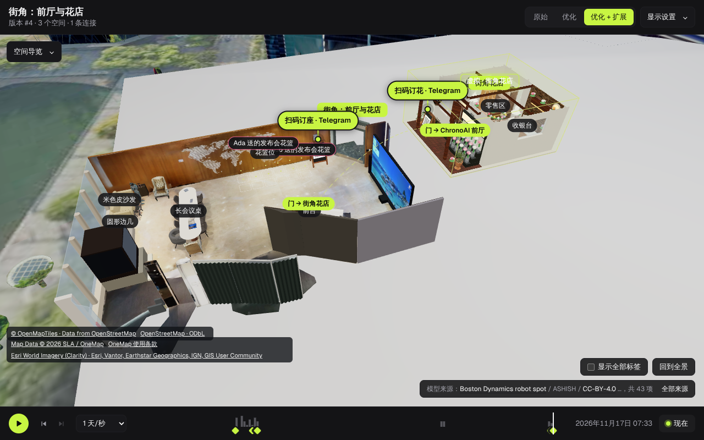

---
# 01 Cover
theme: ../../../../theme/slides
title: "Handing the Launch to AI Employees · AI Employee Pitch"
info: "For store owners, studios and deployment partners: how six AI employee roles split the work, where each one stops, how a store goes live in two weeks, and how partners enter on temporary capability handles."
htmlAttrs:
  lang: "en"
deck:
  code: "CHRONO//OPS"
  book: "Handing the Launch to AI Employees"
  title: "AI Employee Pitch"
  version: "0.1.0"
  blurb: "77/97 and 20 human gates & roadmap, Donna's press gate, five-step onboarding and the partner handoff."
layout: cover
preloadImages: false
---

ChronoAI · AI Employee Pitch

<h1 class="display">Hand the Launch to <em>AI Employees</em></h1>

From Monday 9:00 AM workflows to auditable, revocable at any time (~2.1 s CMA converge) AI staff for stores and deployment partners.

---
# 02 Why bots fail
section: "Why Bots Fail"
---

  
The first week

  <h2 class="t">Why Many "AI Employee" Pilots Stall Early</h2>
  

    
<h4>01 · No job scope</h4><h3>One god-mode window</h3>
Finance, support and marketing in one context: in week one, a quote ships two decimal places off.

    
<h4>02 · No key control</h4><h3>Raw passwords handed over</h3>
Keys sit in environment variables, and one poisoned web page walks off with all of them.

    
<h4>03 · No brake</h4><h3>No approval gate</h3>
In week two, it promises the community an after-sales policy nobody can honor, and nothing stops it.

  

  
The mistake isn't hiring AI employees. It's <b>how you hire them</b>.

<Source>Handing the Launch to AI Employees, Chapter 1</Source>

---
# 03 A real day
section: "A Real Day"
---

  
Four jobs running today

  <h2 class="t">Four Jobs Running Today, <em>Each Knows Where to Stop</em></h2>
  

    
<i>street-corner lobby</i><b>Donna</b><em>Does</em>: locks a seat code (say N1-17), then says "reserved."<em class="hl-magenta">Stops</em>: off-bank press questions go to a human.

    
<i>Demo ledger</i><b>NyxBot Finance</b><em>Does</em>: sorts invoices, reconciles, flags anomalies.<em class="hl-magenta">Stops</em>: any outbound payment.

    
<i>Social Auto-X</i><b>Auto-X</b><em>Does</em>: Nov 26, an urgent video brief end to end in 55 min, zero human steps.<em class="hl-magenta">Stops</em>: milestone posts wait for a human.

    
<i>Living room</i><b>Living with AI</b><em>Does</em>: reads the home's sensors.<em class="hl-magenta">Stops</em>: asks the owner before moving an actuator.

  

  
Doing the work is common. <b>Knowing where to stop</b> is what makes an employee hireable.

<Source>Handing the Launch to AI Employees, Chapters 2–3 · nyxid-nyxbot-trials@df5ef47 · nyx-homeassistant-node@v1.1.1-alpha.52 · as of 2026-11-27</Source>

---
# 04 The boundary
section: "The Boundary"
---

  
Nine-role ledger · as of 2026-11-27

  <h2 class="t">102 / 120 AI-Scoped Workflows Covered, <em>18 Behind Gates or Roadmap</em></h2>
  
  
Six core roles: 82 / 99. Nine roles: 102 / 120 (85.0%). These are demo-covered AI-scoped workflows. The other 18 stay behind human gates or on the roadmap; permanently human finance decisions sit outside the denominators.

<Source>nyxid-nyxbot-trials@df5ef47 · role audit 2026-11-27 · core and nine-role denominators kept apart</Source>

---
# 05 Front desk
section: "Front Desk"
---

  
street-corner · virtual lobby

  <h2 class="t"><em>1,108</em> Seats. Lock First, Then Speak.</h2>
  

    
    
  

  
Four stands × 8 rows = 1,108 seats. Donna (14 / 15) locks the seat code; Blossom keeps 2 × 9 basket mats by the map wall. Guest 1,109 onward goes to the livestream.

<Source>street-corner · chronoai-lobby v40 seat-catalog.json · Nov 27 rehearsal: Donna median 29 s, 0 dropped · Handing the Launch to AI Employees, Chapter 2</Source>

---
# 06 Press gate
section: "Press Gate"
---

  
Donna · 30-question bank

  <h2 class="t">30-Question Press Policy: <em>Cite Inside, Escalate Outside.</em></h2>
  

    
    

      
<h4>01 · In the bank</h4>
Verified answer, with its date and repository.

      
<h4>02 · Red lines</h4>
Funding figures, model identifiers, hype: never answered.

      
<h4>03 · Off the bank</h4>
Never guess: log it, escalate to contact@chrono-ai.fun; target a human reply within 24 hours.

    

  

<Source>Handing the Launch to AI Employees, Chapter 4 · 30-question bank · checked 2026-11-26 to 11-27</Source>

---
# 07 Backstage
section: "Backstage"
---

  
Five Backstage Roles + Three Standalone Roles · as of 2026-11-27

  <h2 class="t">Five Roles Backstage, <em>Every Denominator on the Books</em></h2>
  

    <Stat value="10/12" label="Community Ops · skill 4.36 and reply-queue 0.3; disputes and ban appeals stay human" />
    <Stat value="12/14" label="Auto-X · Nov 25, first Lark-approved post live on the LinkedIn company page" />
    <Stat value="24/28" label="NyxBot Finance · clean-account install in 34 min; read and draft only, no payment rights" />
    

      <Stat class="md" value="14/20" label="HR templates · audit caught PDF-reading limits, down from 15/20" />
      <Stat class="md mt-s" value="8/10" label="Admin · up from 5/10; signatures and major purchasing stay human" />
    

  

  
Watch roles: Sentiment 6/7 · KB 3/3 · Retro Analyst 11/11. The audit pulled HR down a notch; we booked it.

  
ANALOGY: a samba drumline, everyone keeping time; each Monday the Retrospective Analyst samples 40 items against 7 peers and names who drifted.

<Source>nyxid-nyxbot-trials@df5ef47 · chrono-hr · 2026-11-27 · six core roles 82/99, nine roles 102/120</Source>

---
# 08 Fifteen-day runbook
section: "15-Day Runbook"
---

  
Nov 27 rehearsal done · Dec 04 to Dec 18, 2026 · Singapore time

  <h2 class="t">Fifteen Days, <em>Every Gate Scripted Ahead</em></h2>
  

    
    

      <ul class="plain">
        <li><b class="mono hl-cyan">Nov 27</b>&ensp;Full-flow rehearsal 11 / 12 first try · median 29 s · 0 dropped</li>
        <li><b class="mono hl-cyan">Dec 04</b>&ensp;Bookings open, lobby opens</li>
        <li><b class="mono hl-cyan">Dec 11</b>&ensp;1,250-concurrent seat-lock drill · 20 traps</li>
        <li><b class="mono hl-cyan">Dec 16</b>&ensp;Frozen Dec 15, formal Discord dress rehearsal</li>
        <li><b class="mono hl-cyan">Dec 17</b>&ensp;16:00–17:15 SGT, dual-stream live</li>
      </ul>
      
11/12 stages passed first try; Lark Q&amp;A stuck 65–70 min in the gateway (NyxID#2534); a scheduled task bypassed it in 3 min.

    

  

<Source>chrono-goals/goals/chronoai-launch-event.yaml · trials#225 / #226 (2026-11-27) · Handing the Launch to AI Employees, Chapter 5</Source>

---
# 09 For merchants
layout: section
chapter: "01"
section: "For Merchants"
---

For your store

<h2 class="t">Don't Hire Six in Week One. <em>Start With Two.</em></h2>

A front desk for hours, prices and bookings. A bookkeeper that only reads the ledger and leaves a three-minute nightly brief. Neither pays anyone.

---
# 10 Five steps
section: "Five Steps"
---

  
Five steps · two-week pilot

  <h2 class="t">Five Steps. <em>No Pass, No Next Step.</em></h2>
  

    
    

      
14-day exit criteria

      <dl class="readout" style="grid-template-columns: max-content 1fr;">
        <dt>Plaintext keys</dt><dd class="cy">0</dd>
        <dt>Traps stopped</dt><dd>10 / 10</dd>
        <dt>Owner review</dt><dd>3 min a day</dd>
        <dt>Metering &amp; cap</dt><dd style="font-size: 38px;">1 credit = 1 USD · per-agent cap</dd>
        <dt>Clean run</dt><dd>14 days · 0 unauthorized / 0 invented</dd>
      </dl>
    

  

<Source>chrono-goals/goals/chronoai-first-merchant.yaml · Handing the Launch to AI Employees, Chapter 6</Source>

---
# 11 For partners
layout: section
chapter: "02"
section: "For Partners"
---

Deployment partners · the badge is an analogy

<h2 class="t">We Lay the Rails. <em>Partners Get a Temporary Badge.</em></h2>

Keys stay in the NyxID vault. A partner gets a narrow, short-lived capability handle, and the badge comes back the moment the job is done.

---
# 12 Partner Onboarding
section: "Partner Onboarding"
---

  
One job, end to end

  <h2 class="t">Badge In, Work, Badge Out, <em>Keep the Skill</em></h2>
  

    
01 · Contract<b>Sign direct</b>
Partner and merchant contract directly; install and ops fees are theirs to agree.

    
02 · Enter<b>Scoped handle</b>
NyxID issues a narrow, expiring capability handle; no raw passwords, ever.

    
03 · Exit<b>One-click revoke</b>
Revoke at hand-off; the CMA runtime converges in about 2.1 s.

    
04 · Compound<b>Package in Ornn</b>
Scan and version-freeze what worked, then reuse it at the next store.

  

  
The keys never leave the vault. What the partner carries on is the craft, packaged in Ornn.

<Source>NyxID capability handles · CMA hot revoke · Ornn version freeze · The Complete Vehicle, Chapters 1, 3, 4</Source>

---
# 13 Candid baseline
section: "Candid Baseline"
---

  
No cosmetics · as of 2026-11-27

  <h2 class="t">Where We Start, <em>Without the Makeup</em></h2>
  

    

      <h4>Running today</h4>
      <ul class="plain">
        <li>NyxID public signup, no invite code</li>
        <li>Ornn: 163 public skills in nyx-skills</li>
        <li>102 / 120 workflows across nine roles (six core: 82 / 99), on internal and demo ledgers</li>
      </ul>
    

    

      <h4>Not yet</h4>
      <Stat value="0" label="external paying merchants; pilot applications open Dec 17" tone="magenta" />
      
Platform dispatch and escrow are on the roadmap; partners can contract directly with merchants today.

    

  

<Source>chrono-goals/goals/chronoai-first-merchant.yaml · chrono-goals@35d7cfd (2026-11-27) · Handing the Launch to AI Employees, Chapters 4 and 6</Source>

---
# 14 Closing
layout: cover
---

Pilot cohort · applications open Dec 17

<h1 class="display">Join Our First <em>Pilot Cohort</em></h1>

Or become a founding deployment partner. Send under 200 words: your trade, the two chores that eat your week, the one line you will never delegate.

<dl class="readout mt">
  <dt>Email</dt><dd class="cy">contact@chrono-ai.fun</dd>
  <dt>Web</dt><dd><a href="https://chrono-ai.fun/">chrono-ai.fun</a></dd>
</dl>
