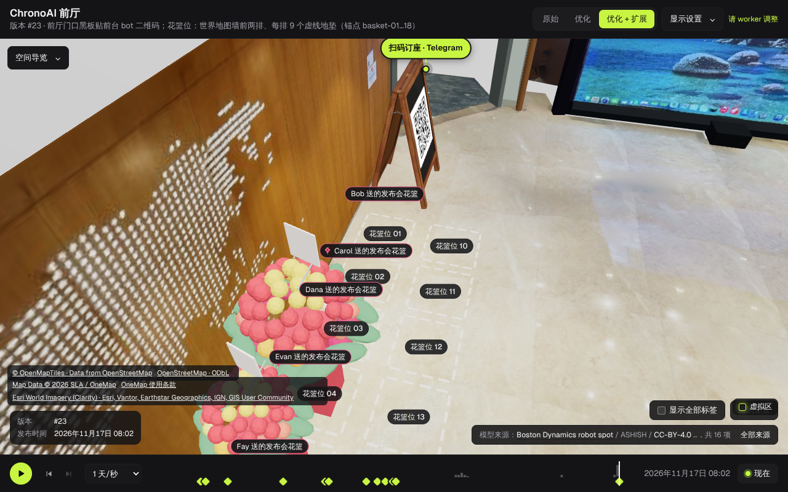
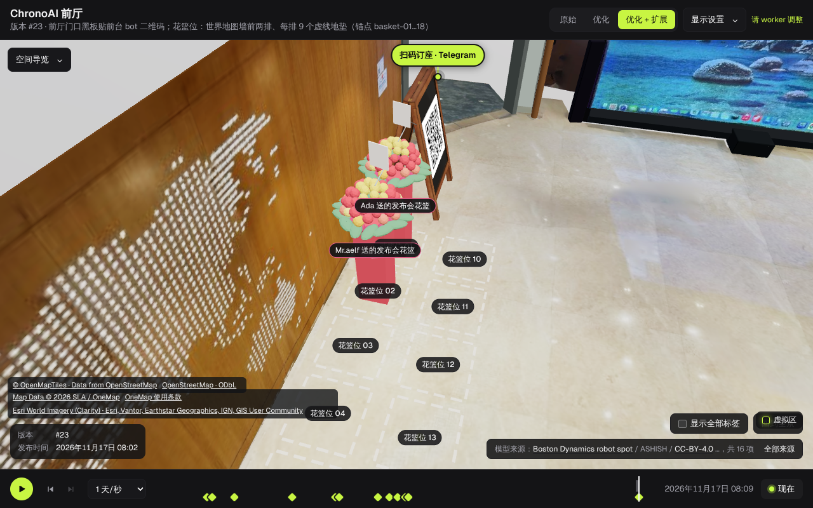

# Chapter 4: Street Corner: A Virtual Venue That Runs Itself

If a company claims it has built AI employees trustworthy enough to staff your front desk, yet rents a five-star hotel ballroom and hires a line of humans in suits to run its own launch—any sharp skeptic would burst out laughing, and any impatient physicist in the front row would ask: *"If your machine is so reliable, why didn't you let it arrange the chairs at the door?"*

So we skipped the hotel, skipped the film crew, and built a permanent, open online launch lobby on our own 3D spatial engine, `chrono-metaverse`: **Street Corner (`street-corner`)**.

Open `https://chrono-metaverse-chronoai.apps.nyxid.ai/workspace?space=street-corner&view=extended` and complete a quick one-click **`NyxID` sign-in** (`invite_code_required: false`, open public signup via GitHub, Google, or Apple—while the YouTube `@ChronoAIOfficial` and LinkedIn Live streams remain completely login-free). Rather than hitting a lifeless registration form, you step onto a live, walkable street corner: dead ahead glows the ChronoAI reception desk staffed by AI Concierge **Donna** (formal Telegram booking bot `@chronoai_frontdesk_bot`); across the promenade sits **Flower Town**, tended by **Blossom**; and rising behind the plaza sit six concentric theater rings holding exactly **1,108 reservable seats**.

## From Opening the Lobby Link to a Locked Seat: A Five-Step Loop Designed for Zero Collisions

Moving a real launch into a 3D lobby rarely fails because the lighting looks dull; it fails on **state consistency under concurrency**. When bookings open on December 4, 2026—or when hundreds of guests rush through the gate ten minutes before the December 17 keynote—what prevents two browsers from claiming Seat #412 at the exact same instant? And what keeps Guest #1,109 from staring at an ugly error page?

We engineered the entire visitor journey as a five-stage deterministic flow: lobby link entry, zero-secret `NyxID` sign-in, concierge triage by **Donna**, atomic seat locking or Flower Town basket placement, and seamless handoff into the 16:00 SGT livestream stage.

::: {.figure src="ch04-street-corner-flow"}
**Street Corner Five-Stage Guest Flow & Atomic Booking Lock.** Visitors open the lobby link and authenticate via `NyxID`, check in with Donna, branch cleanly into atomic theater seating (`1,108`-seat cap) or Flower Town celebratory basket stands (`18` numbered slots), and enter the 16:00 SGT livestream stage.
:::

Rather than asking you to imagine how the floor handles rush hour, our interactive lab `LAUNCH//ARENA` (a client-side deterministic schematic model) puts all six concentric rings ($96 + 144 + 176 + 204 + 232 + 256 = 1{,}108$ seats) and all 18 flower-basket stands on a live canvas you can inspect yourself. Begin with the quiet pre-doors floorplan:

::: {.viz src="launch-arena" preset="lobby" height="500"}
**Street Corner Overview (`lobby`).** Pre-doors architectural map of `street-corner`: Donna's reception desk and Blossom's 18 numbered flower-basket stands on the left promenade, paired with six concentric rings totaling 1,108 open seats on the right.
:::

Now open the doors. The `booking` card illustrates an opening arrival wave filling Rings 1 through 3—416 concurrent guests locking seats. Watch the collision counter at the bottom: under the atomic booking lock's design invariant, **the model holds duplicate-seat collisions at `0`**, binding each confirmation code to one unique seat ID—the exact acceptance bar for our December 11 load drill.

::: {.viz src="launch-arena" preset="booking" height="500"}
**Atomic Seat Lock (`booking`).** Illustrates incoming arrivals filling Rings 1–3 (`416` seats confirmed in cyan) while the atomic booking lock holds duplicate-seat collisions at `0`.
:::

Next comes the boundary case that separates real operations from fragile demos: **what happens when 1,250 guests arrive for a 1,108-seat theater?** Flashy virtual venues either crash the server or silently stack avatars on top of one another. Our routing invariant—modeled in the `overflow` experiment card below and set as our December 11 load-drill acceptance bar—is crisp and unforgiving: seats 1 through 1,108 stay strictly locked inside the 3D arena, and from Guest #1,109 onward, Donna delivers an immediate, polite full-house notice and routes the guest straight into the synchronized YouTube (`@ChronoAIOfficial`) and LinkedIn Live stream, **targeting zero collisions and zero stranded guests.**

::: {.viz src="launch-arena" preset="overflow" height="500"}
**Full-House Overflow (`overflow`).** At 1,250 arrivals, all 1,108 theater seats remain locked with zero collisions while the 142 overflow guests route cleanly to the synchronized YouTube and LinkedIn Live broadcast.
:::

## Flower Town, Blossom, and Eighteen Celebratory Stands

If the theater rings embody order and concurrency safety, **Flower Town** across the square gives an agent-staffed virtual venue its human warmth. Across Asia, opening days and product launches are greeted with celebratory flower stands from partners, contributors, and friends. Along the promenade we reserved **18 numbered flower-basket stands**, each anchored to exact 3D coordinates and a visible greeting plaque.

These stands are live spatial objects, not baked wallpaper. A visitor walks to Flower Town, chats with **Blossom** to select an arrangement and sign a greeting card, and watches a unique 3D flower basket materialize on its assigned promenade stand for every arriving guest to read.

The `basket` schematic card below illustrates all 18 promenade stands—12 lit with sample placed arrangements and 6 glowing amber awaiting claims. Behind each real basket interaction runs the full vehicle: `NyxID` scoped permissions, `NyxBot` specialist workflows, and the `chrono-metaverse` spatial write protocol.

::: {.viz src="launch-arena" preset="basket" height="500"}
**Flower Basket Stands (`basket`).** Highlights the 18 numbered promenade slots (12 placed, 6 open in amber), tracing how a guest's greeting card moves through Blossom's checkout directly into a live 3D stand.
:::

## Forty-Seven Seconds Through Street Corner

For a kinetic walkthrough of the entire guest experience—from greeting Donna at reception, through locking all six theater rings, to placing a celebratory basket in Flower Town—watch the forty-seven-second venue tour film below.

::: {.film src="from-flower-to-seat"}
**From a Flower Basket to a Seat (Venue Tour Film).** A 47-second tour of `street-corner`: Donna's 30-question concierge desk, atomic locking across 1,108 theater seats, graceful livestream overflow, and Blossom's 18 Flower Town stands.
:::

## Donna's Guardrails: Why Knowing When to Escalate Beats Knowing Everything

The most underrated engineering choice in the entire lobby is **what Donna refuses to answer**.

Behind her sits an operational suite covering **13 of 15 concierge workflows** (verified November 25, 2026) and a **locked 30-question approved press Q&A bank** (published verbatim in Volume IV, *Handing the Launch to AI Employees*, Chapter 4). Ask anything inside the bank—what ChronoAI builds, where the repos live, what works today, what is still unfinished—and Donna answers immediately with exact dates and repository citations. Press her for undisclosed financial numbers, unverified delivery promises, or inflated scientific claims, and the hard guardrail fires: **never improvise, log the question, and escalate cleanly to `contact@chrono-ai.fun` for a human reply.**

That is why a self-running virtual venue is far more than theater: it is the first live receipt for our complete-vehicle stack. Open the full `LAUNCH//ARENA` laboratory below, drag the arrival load from `1` to `1,250`, click any ring or flower stand, and stress-test Street Corner yourself.

::: {.viz src="launch-arena" height="560"}
**Full Laboratory: `LAUNCH//ARENA`.** Drag concurrent arrival load (1–1,250), step through all five experiment cards, and click individual theater rings or the 18 flower-basket stands to inspect atomic locking and overflow curves live.
:::

Now take your seat as the house lights dim. The first beam hitting the main screen does not illuminate a marketing slogan; it illuminates a proving ground colder than any market and far less forgiving than any press conference—**pure mathematics and the Lean 4 kernel**. Why does an agent-infrastructure company choose automated open-math discovery as its North Star? Look up in Chapter 5.
