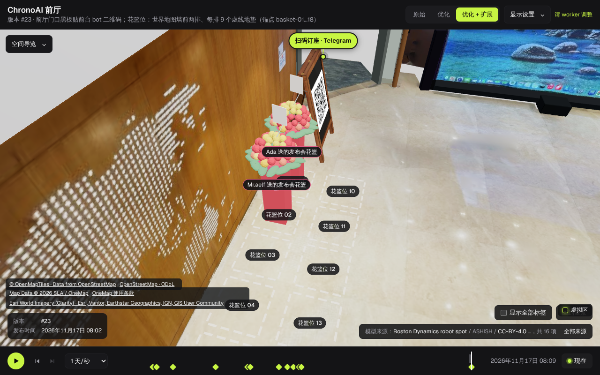

---
# 01 Cover
theme: ../../../../theme/slides
title: "Build for What Comes Next · 2026 Virtual Launch Keynote"
info: "The ChronoAI 2026 virtual launch keynote: devalued execution, the logic ratchet, the complete vehicle, and Street Corner."
htmlAttrs:
  lang: "en"
  data-polarity: "deep-space"
deck:
  code: "CHRONO//KEYNOTE"
  book: "Build for What Comes Next"
  title: "2026 Virtual Launch Keynote"
  version: "0.1.0"
  blurb: "Devalued execution, the logic ratchet, the complete vehicle, and Street Corner: 20 crisp keynote slides."
layout: cover
preloadImages: false
---

Dec 17, 2026 · 16:00 SGT · Zero Cameras · Virtual Launch on Our Stack

<h1 class="display">Build for What Comes <em>Next</em></h1>

Zero cameras. No outside agency. One engine-agnostic vehicle, and a one-way ratchet of logic.

---
# 02 Cold open
section: "Right Now"
---

  
Cold Open

  <h2 class="t">You're Inside a Launch With <em>Zero Film Crew</em></h2>
  

    

      
This 3D lobby, 1,108 theater seats, 18 flower-basket mats, the full launch film plus five shorts, four bilingual books, and Concierge Donna—built on ChronoAI's own agent stack under human review and gates, and published in the open.

      

        <Stat class="md" value="0" label="cameras" tone="magenta" />
        <Stat class="md" value="1,108" label="atomic-lock seats" />
        <Stat class="md" value="4" label="auditable open books" />
      

    

    
  

<Source>Street-corner virtual lobby and bookings · open Dec 4 at 10:00 SGT · live broadcast Dec 17 at 16:00 SGT</Source>

---
# 03 Thesis
section: "Act I · Stance"
---

  
Revaluation · Stance (not a theorem)

  <h2 class="t">Execution Fell Through the Floor. <em>Judgment Wears the Crown.</em></h2>
  

    

      <h4>The Inversion</h4>
      <h3>When building approaches zero marginal cost, building the wrong thing accelerates a hundredfold.</h3>
      
Only three assets stay scarce: taste, hard boundaries, and incorruptible judges.

    

    

      <h4>Compass &amp; Ratchet</h4>
      <h3>Beauty is the compass; logic is the ratchet.</h3>
      
Hand the ratchet to the machine and keep the compass in human hands—so people are free to build what genuinely thrills them.

    

  

<Source>Engineering thesis and analogy, not a formal theorem · Vol. I, Ch. 1</Source>

---
# 04 Telemetry
section: "Act I · Evidence"
---

  
Open the Logs

  <h2 class="t">About Fifteen Engineers. Sixty Days. <em>141,624</em> Commits.</h2>
  

    <Stat value="141,624" label="commits in 60 days across 74 repos spanning ChronoAI and The Omega Institute" />
    <Stat value="35%" label="explicit agent / bot account share" tone="magenta" />
    <Stat value="~15" label="full-time human engineers" />
  

  

    <h4>The Only Question That Matters</h4>
    
Anyone can script empty commits. Ask the real question: <strong>why didn't 141,624 commits in sixty days collapse the codebase into an uncompilable heap by Day 7?</strong> Two answers: executable judges, and the Lean 4 kernel.

  

<Source>74 active repos, Sep 20–Nov 19, 2026; identity split over 69 repos (Nov 7)</Source>

---
# 05 Act II
layout: section
chapter: "02"
section: "Act II · North Star"
---

Act II · The Omega Institute · An Independent Research Brand, Not a ChronoAI Product

<h2 class="t">The North Star: <em>The Ratchet of Logic</em></h2>

A system that flatters its maker is a toy. The Omega Institute drove the same engineering discipline onto civilization's coldest proving ground (analogy)—pure mathematics and the Lean 4 kernel.

---
# 06 Scale
section: "North Star · Scale"
---

  
From Intuition to Kernel

  <h2 class="t">Handing Raw Intuition to <em>Lean 4</em> Around the Clock</h2>
  

    

      
<Tex display t="x^2 = x + 1" />

      
It began with one stubborn question: when an observer sees the world through a finite binary window, what structure must appear?

      
From the golden equation and <code>FIB ATOM</code>, agents derive day and night while Lean 4 rules on every line. The ratchet bites one tooth at a time (analogy)—<b>no theorem talks its way through.</b>

    

    

      <Stat class="md" value="223,231" label="frozen Lean 4 theorems (400,377 frozen declarations)" tone="ok" />
      <Stat class="md" value="17,968" label="frozen modules · 6.02M lines" />
      <Stat class="md" value="720/720" label="consecutive UTC hours with commits · median 63 an hour" tone="magenta" />
      <Stat class="md" value="217" label="merged PRs per day (Nov 20–26)" />
    

  

<Source>The Omega Institute · trureturing@548388cd (Nov 27, 2026) · cadence Oct 28–Nov 26 · Lean 4.35.0</Source>

---
# 07 Literature
section: "North Star · Literature"
---

  
81 Days in the Open Literature · No Self-Set Exams

  <h2 class="t">81 Days. <em>2,278</em> Open Literature Resolutions.</h2>
  

    
    <ul class="plain">
      <li><b class="hl-cyan">1,512 proved · 766 refuted</b> About 28 a day, including 598 in quantum information and physics.</li>
      <li class="mt"><b class="hl-cyan">684 from peer-reviewed journals</b> Plus 840 from arXiv and 729 from OEIS; 127 open for at least ten years, the oldest for 47 years.</li>
      <li class="mt"><b class="hl-magenta">Auditable live</b> Refuted the PRA 2025 Fredkin bound (&gt;2 ebits); proved the Higuchi–Sudbery entropy bound and the CMP 2026 Zeitlin curvature limit.</li>
    </ul>
  

<Source>trureturing@548388cd (Nov 27, 2026) · Sep 8–Nov 27 · 2,276 dated + 2 undated = 2,278</Source>

---
# 08 Iron laws
section: "North Star · Laws"
---

  
Kernel-Checked Iron Laws · Analogy &amp; Theorem

  <h2 class="t">You Cannot Mine the Same Gold Twice— <em>Nor Trust Local Checks Alone</em></h2>
  

<TheoremCard class="compact" label="Theorem 5.1" title="A Recoverable Theorem Cannot Lower Information Escape" gid="D5/S3/ConceptDynamics/InformationEscape/StructuralNovelty.lowersEscape_false_of_recoverable" cite="thm-keynote-novelty">

If, for every pair of states, agreement on all other catalog entries implies agreement on entry `index`, then it cannot strictly lower the information escape rate: $\neg\,\mathrm{LowersEscape}(\mathrm{index})$.

</TheoremCard>
<TheoremCard class="compact" label="Theorem 5.2" title="Pairwise Compatible Local Laws Can Lack Any Global State" gid="D5/S3/ConceptDynamics/Gluing/LocalLawGluingObstruction.compatible_local_laws_can_lack_global_state" cite="thm-keynote-gluing">

On $\mathrm{Bool}$, the equality law $\mathrm{sameLaw}$ and the inequality law $\mathrm{differentLaw}$ match on every pairwise marginal, yet no global state $(b_1, b_2, b_3)$ has $b_1 = b_2$, $b_2 = b_3$ and $b_1 \neq b_3$.

</TheoremCard>
  

<Source>Headline is an intuition; the cards state the Lean theorems · D5/S3/ConceptDynamics · Vol. I, Ch. 5 · click a green badge for the Lean source</Source>

---
# 09 Glass house
section: "North Star · Glass House"
---

  
live.trureturing.org

  <h2 class="t">Smash the Black Box: <em>An Eight-Department Glass Observatory</em></h2>
  

    
    

      <Stat value="19,022" label="live truth nodes · 8 spiral galaxies · 17 public repositories" />
      <ul class="plain mt tight">
        <li><b>Eight functional departments</b> Direction · Math Research · Independent Review · Verification · Monographs · Papers &amp; Wiki · Scholar Outreach · Tools &amp; Studio</li>
        <li class="mt-s"><b>Five-step audit: trust the compiler, not applause</b> Published conjecture → green badge → Lean line → frozen state &amp; statement_id → local single-module lake build + #print axioms</li>
      </ul>
    

  

<Source>Live capture of live.trureturing.org (Nov 27, 2026) · Vol. III, App. A five-step playbook</Source>

---
# 10 Candor
section: "North Star · Candor"
---

  
External Reality &amp; Red Lines

  <h2 class="t">485 Scholars Replied. <em class="warn">Red Lines We Won't Hide.</em></h2>
  

    <Stat class="md" value="485" label="scholars replied of 1,049 contacted (46.2%, 47 countries)" />
    <Stat class="md" value="316" label="positive · 44 co-authoring" />
    <Stat class="md" value="21" label="OEIS entries · 17 collaborative arXiv preprints · 1 RAIRO-ITA paper" />
    <Stat class="md" value="0" label="Mathesis peer-review acceptances of 225 papers" tone="warn" />
  

<TheoremCard class="compact mt-s" label="Open problem 5.4" title="Beyond Classical RH: Extended RH, Grand RH, Zero Simplicity, and Pair Correlation" status="open" cite="prob-keynote-rh">

The Extended RH for Dedekind $\zeta$ of general number fields, the Grand RH for automorphic $L$-functions, simplicity of zeros, and pair correlation: <b>still open today</b>.

</TheoremCard>
  
Classical RH and Dirichlet GRH sit outside the red zone: Levent Alpöge's Lean 4 proof, certified by the Lean and Mathlib communities (Nov 20–21), is external work; The Omega Institute built only the 8,490-shard <code>./verify</code> replay, and trureturing proves only the integer Hankel equivalence. 66 scholars declined or asked to stop—logged too.

<Source>trureturing-outreach@d22e63c8 (Nov 27) · Mathesis (Nov 27) · riemann-hypothesis@c2dabc97 · candor gives green badges their weight</Source>

---
# 11 Act III
layout: section
chapter: "03"
section: "Act III · Complete Vehicle"
---

Act III · ChronoAI Infrastructure · Analogy

<h2 class="t">Anyone Can Buy an Engine. <em>We Build the Vehicle.</em></h2>

Drop a 500-horsepower bare engine on concrete and stomp the gas—you don't get a lap time; you wreck the garage.

---
# 12 Cutaway
section: "Vehicle · Cutaway"
---

  
Hot-Swappable Core · Analogy (not a theorem)

  <h2 class="t">Swap the Engine Tomorrow. <em>Never Stall the Car.</em></h2>
  
  
Model turnover is fast. <b>Bolt identity, skills, sandboxes, and judges into the chassis so every guardrail stays intact across core swaps.</b>

<Source>Engineering analogy, not a theorem · Vol. I, Ch. 2</Source>

---
# 13 Red Queen
section: "Vehicle · Red Queen"
---

  
NyxID v0.78.0 · Open Today

  <h2 class="t">Our Own <em>Red Queen</em>—Except She Works for You</h2>
  

    

      <Stat value="0" label="plaintext keys ever entering agent context" />
      <Stat class="mt-l" value="~2.1" unit="s" label="CMA cloud hot credential reload, revoke without restart" tone="magenta" />
    

    

      <h4>Hand Over a Scoped Badge, Never the Vault Key</h4>
      <ul class="plain">
        <li><b>Open public signup today</b> (no invite code) · <code>1 credit = 1 USD</code> + BYOK</li>
        <li><b>55</b> built-in services · <b>42</b> OpenAPI→MCP specs · <b>9</b> channel types (<b>11</b> on dev 0.79.0)</li>
        <li>High-risk writes pause for human sign-off; revoke once and the next call fails</li>
      </ul>
    

  

<Source>ChronoAIProject/NyxID@v0.78.0 (898fdf245d) · api.nyxid.ai and dev@6784b6dd36 (Nov 27, 2026) · hot reload measured on CMA · "Red Queen" and "badge" are analogies</Source>

---
# 14 One network
section: "Vehicle · One Network"
---

  
Not Four Apps — One Network

  <h2 class="t">Out of the Chat Box: <em>One NyxBot Across Physical &amp; Digital Life</em></h2>
  

    
<i>Campus · Running</i><b>Walk the Robot Dog</b>One chat message routes through NyxID → Home Assistant and sends the quadruped out on patrol.

    
<i>Office · Running</i><b>The Snack Butler</b>A shelf camera spots the chips running out, polls the team chat, and stages the restock order.

    
<i>3:00 AM · Ops</i><b>Diagnose First, Wait for Yes</b>Reads logs and drafts the fix overnight; touches production only after your morning tap.

    
<i>Live · Dec 17</i><b>Four Stands, 1,108 Seats</b>The same network drives Donna's reception desk, atomic seat locks, and 18 flower-basket mats.

  

<Source>nyx-homeassistant-node v1.1.1-alpha.52 · live team demos and the Dec 17 venue</Source>

---
# 15 Stack and candor
section: "Vehicle · Stack & Candor"
---

  
Skills · Runtimes · Judges — unfinished bolts left visible

  <h2 class="t">Audited Skills, Twin Cockpits, and <em>Executable Judges</em></h2>
  

    

      <h4>Ornn v0.18.0 · Skill Lifecycle</h4>
      <h3>134 ops (109 paths) · 163 skills</h3>
      
286 test files · AgentSeal scanning

      
<b class="hl-warn">Honest limit</b>  Public alpha

    

    

      <h4>CMA + heca · Cloud &amp; Local</h4>
      <h3>Zero-ops Cloud · 27 Agent Types</h3>
      
<b>CMA v0.12.0</b> (Apache-2.0) in the cloud; the <b>heca</b> canvas locally (360 nightlies)

      
<b class="hl-warn">Honest limit</b>  CMA runs a single primary coding runtime today; heca source pending

    

    

      <h4>chrono-harness · Judges</h4>
      <h3>25 public repos · 21 binaries per platform</h3>
      
Copier v0.1.52 · 29 atomic rules; fail-closed <code>FILEMAP</code>, precise <code>DELTA</code> selection

      
<b class="hl-warn">Honest limit</b>  the judges hardcode <code>completeness_proven: false</code>

    

  

<Source>github.com/chrono-harness (Nov 27, 2026) · CMA@v0.12.0 (Nov 24) · heca 0.1.0-nightly-20261121-1 · Vol. II, App. B</Source>

---
# 16 Act IV
layout: section
chapter: "04"
section: "Act IV · AI Employees"
---

Act IV · Real Operations

<h2 class="t">Walk Out With <em>Your First AI Employee</em></h2>

Skip the omnipotent magic chatbot. Hire a scoped team with clear desks, hard brakes, and audited ledgers.

---
# 17 Lobby
section: "Lobby · Live"
---

  
Inside street-corner · Nov 27 Full-Flow Rehearsal

  <h2 class="t">Donna &amp; Blossom: <em>Zero Clashes</em>, 29 s Median</h2>
  

    
    <ul class="plain">
      <li><b class="hl-cyan">Four stands × 8 rows = 1,108 seats</b> N 248 · S 248 · E 306 · W 306; rows 144, 144, 144, 140, 136, 136, 132, 132; codes N1-17, E1-20, W8-01</li>
      <li class="mt"><b class="hl-cyan">18 flower-basket mats (2 rows of 9)</b> basket-01…basket-18 along the world-map wall, by Blossom</li>
      <li class="mt"><b class="hl-cyan">Rehearsal: 13 bookings and check-ins, 0 dropped</b> Median 29 s, max 63 s—measured, not promised</li>
      <li class="mt"><b class="hl-cyan">Donna's 30-question press policy</b> In-bank: cited answers. Off-bank: log and escalate to contact@chrono-ai.fun</li>
    </ul>
  

<Source>chronoai-lobby v40 seat catalog · trials#225/#226 full-flow rehearsal (Nov 27, 2026) · Vol. IV, Ch. 2–4</Source>

---
# 18 Ledger
section: "AI Staff · Ledger"
---

  
Nine Standalone Roles · Nov 27, 2026

  <h2 class="t">102 / 120 AI-Scoped Workflows Covered, <em>18 Behind Gates or Roadmap.</em></h2>
  

    
    

      <h4>Why We Refuse 100% Automation</h4>
      <h3>102 / 120 are covered AI-scoped workflows.</h3>
      
Six core roles: 82/99; nine roles reach 102/120 (85.0%), all demo-covered AI-scoped workflows. The other 18 stay behind human gates or on the roadmap; permanently human finance decisions sit outside the denominators.

      
<b class="hl-warn">Full candor</b>  Nov 27 rehearsal: 11 of 12 stages passed first try; a Lark Q&amp;A stalled 65–70 min in the gateway queue (NyxID#2534), bypassed by a one-shot task in 3.0 min. Paying merchants: <b>0</b>; <b class="hl-amber">pilot applications open Dec 17</b>.

    

  

<Source>nyxid-nyxbot-trials@df5ef47 and trials#225/#226 (Nov 27, 2026) · chrono-goals@35d7cfd · Vol. IV, Ch. 1</Source>

---
# 19 Invitation
section: "Invitation"
---

  
Not a Job Posting

  <h2 class="t">Four Doors <em>Standing Open</em> Today</h2>
  

    

      <h4>Systems Builders</h4>
      <h3>Audit &amp; Ship a PR</h3>
      
Inspect NyxID, Ornn, and chrono-harness directly. One sharp patch beats ten résumés.

    

    

      <h4>Mathematicians &amp; Physicists</h4>
      <h3>Audit in Five Steps + lake build</h3>
      
Open any green badge on live.trureturing.org, or bring a stubborn open conjecture.

    

    

      <h4>First Pilot Merchants · Dec 17</h4>
      <h3>Two Roles in 14 Days</h3>
      
Start with front desk + finance ledger—no raw passwords handed over, full audit trail.

    

    

      <h4>Deployment Partners</h4>
      <h3>Temp Badges, Real Revenue</h3>
      
Contract directly with clients, revoke temporary capability handles when done, and turn each scenario into a reusable skill.

    

  

<Source>Sole official inbox: contact@chrono-ai.fun · https://chrono-ai.fun/</Source>

---
# 20 Closing
layout: cover
---

ChronoAI 2026 Virtual Launch

<h1 class="display">Build for What Comes <em>Next</em></h1>

Never trust applause—trust every repository, lock, and theorem you verify yourself.

chrono-ai.fun · contact@chrono-ai.fun

