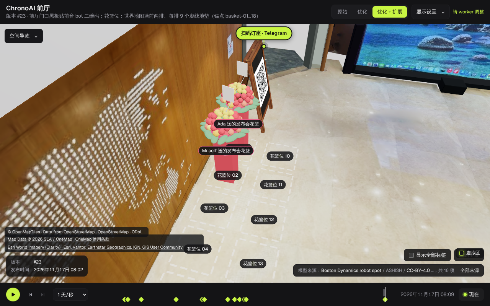

---
# 01 封面
theme: ../../../../theme/slides
title: "面向未来的造物 · 2026 线上发布会主讲稿"
info: "ChronoAI 2026 线上发布会主讲稿：执行贬值、逻辑棘轮、整车底座与街角前厅。"
htmlAttrs:
  lang: "zh-CN"
deck:
  code: "CHRONO//KEYNOTE"
  book: "面向未来的造物"
  title: "2026 线上发布会主讲稿"
  version: "0.1.0"
  blurb: "执行贬值、逻辑棘轮、整车底座与街角前厅：20 页精粹主讲稿。"
layout: cover
preloadImages: false
---

2026 · 12 · 17 · 16:00 SGT · 零摄影机 · 零外包 · 智能体协同打造

<h1 class="display">面向未来的<em>造物</em></h1>

零摄影机。零外包。一辆可换发动机的整车，一只只进不退的逻辑棘轮。

---
# 02 冷开场
section: "此刻"
---

  
开场 · 实拍前厅

  <h2 class="t">你正坐在一场<em>没有人类摄制组</em>的发布会里</h2>
  

    

      
这座前厅、1,108 个剧场座位、18 座花篮、五部短片、四部双语书，以及门口的礼宾 Donna——在人类审校与闸门下，由 ChronoAI 智能体底座协同生成并公开托管。

      

        <Stat class="md" value="0" label="台摄影机" tone="magenta" />
        <Stat class="md" value="1,108" label="原子锁席位" />
        <Stat class="md" value="4" label="部可核验开源专著" />
      

    

    
  

<Source>street-corner 虚拟会场实拍 · 2026-12-17 同步开放</Source>

---
# 03 立场
section: "第一幕 · 立场"
---

  
价值重估 · 立场（非定理）

  <h2 class="t">执行跌穿地板，<em>判断加冕为王</em></h2>
  

    

      <h4>价值反转</h4>
      <h3>当把事情做出来的成本趋近于零，做错事情的速度就乘以一百。</h3>
      
真正稀缺的只剩三样：问题眼光、权限边界，以及绝不奉承制造者的冷酷判官。

    

    

      <h4>罗盘与棘轮</h4>
      <h3>美是罗盘，逻辑是棘轮。</h3>
      
棘轮交给机器，罗盘握在人手——让机器扛起重复劳动，好让每个人都去造自己真正觉得酷的东西。

    

  

<Source>立场与类比，非形式化定理 · 第一卷第一章</Source>

---
# 04 实证
section: "第一幕 · 实证"
---

  
翻开仓库日志

  <h2 class="t">约十五名工程师，六十天，<em>141,624</em> 次提交</h2>
  

    <Stat value="141,624" label="60 天总提交 · 74 仓横跨 ChronoAI 与 The Omega Institute" />
    <Stat value="35%" label="显式机器 / Agent 账号提交占比" tone="magenta" />
    <Stat value="~15" label="全职人类工程师" />
  

  

    <h4>唯一值得追问的问题</h4>
    
拿脚本也能刷提交。真正该问的是：<strong>为什么六十天十四万次提交，没有在第七天就把代码库撞成一堆编译不过的废墟？</strong>答案只有两个：硬核判官，与 Lean 4 内核。

  

<Source>74 活跃仓 2026-09-20 至 11-19；身份口径 69 仓（11-07）</Source>

---
# 05 第二幕
layout: section
chapter: "02"
section: "第二幕 · 北极星"
---

第二幕 · The Omega Institute

<h2 class="t">北极星：<em>逻辑的棘轮</em></h2>

只会奉承制造者的系统只是玩具。The Omega Institute 将这套工程底座开进了人类最冷酷的试车场——纯粹数学与 Lean 4 编译器内核。

---
# 06 规模
section: "北极星 · 规模"
---

  
从直觉到内核

  <h2 class="t">把一条直觉交给 <em>Lean 4</em> 昼夜不停地敲打</h2>
  

    

      
<Tex display t="x^2 = x + 1" />

      
起点只是一个极简问题：当观察者只能透过有限二进制窗口看世界，什么结构必然出现？

      
从黄金方程与 <code>FIB ATOM</code> 出发，AI 昼夜推导，Lean 4 逐行裁决——<b>没有一条定理靠口才混过关。</b>

    

    

      <Stat class="md" value="167,819" label="冻结 Lean 4 定理" tone="ok" />
      <Stat class="md" value="14,701" label="冻结模块 · 478 万行" />
      <Stat class="md" value="720/720" label="连续 UTC 小时，每小时都有提交" tone="magenta" />
      <Stat class="md" value="159" label="日均合入 PR" />
    

  

<Source>The Omega Institute · trureturing@05ceb90（2026-11-20）· 节律与 PR 口径 @e55900e（11-19）· Lean 4.35.0</Source>

---
# 07 文献
section: "北极星 · 文献"
---

  
74 天公开文献实战

  <h2 class="t">74 天，<em>2,128</em> 道公开文献题解</h2>
  

    
    <ul class="plain">
      <li><b class="hl-cyan">1,400 证明 · 728 反驳</b> 日均约 29 道，其中量子与物理 582 道。</li>
      <li class="mt"><b class="hl-cyan">674 道出自同行评审期刊</b> 另有 arXiv 736 道、OEIS 693 道；124 道悬置逾十年，最久 47 年。</li>
      <li class="mt"><b class="hl-magenta">当场可验</b> 反驳 PRA 2025 Fredkin 门上界（&gt;2 ebits）；证明 Higuchi–Sudbery 熵界与 CMP 2026 Zeitlin 曲率极限。</li>
    </ul>
  

<Source>trureturing@05ceb90（2026-11-20）· 2,126 带日期 + 2 未标日期 = 2,128</Source>

---
# 08 铁律
section: "北极星 · 铁律"
---

  
内核检验的铁律 · 类比与定理

  <h2 class="t">同一块金子挖不了两次，<em>局部绿灯不等于全局真</em></h2>
  

<TheoremCard class="compact" label="定理5.1" title="可恢复的定理不能降低信息逃逸" gid="D5/S3/ConceptDynamics/InformationEscape/StructuralNovelty.lowersEscape_false_of_recoverable" cite="thm-keynote-novelty">

若对任意一对状态，只要目录中其余条目都一致，就能推出条目 `index` 也一致，则它不能严格降低信息逃逸率：$\neg\,\mathrm{LowersEscape}(\mathrm{index})$。

</TheoremCard>
<TheoremCard class="compact" label="定理5.2" title="两两相容的局部律未必拼出全局态" gid="D5/S3/ConceptDynamics/Gluing/LocalLawGluingObstruction.compatible_local_laws_can_lack_global_state" cite="thm-keynote-gluing">

在 $\mathrm{Bool}$ 上，相等律 $\mathrm{sameLaw}$ 与不等律 $\mathrm{differentLaw}$ 的边缘投影两两一致，却不存在全局态 $(b_1, b_2, b_3)$ 使 $b_1 = b_2$、$b_2 = b_3$ 且 $b_1 \neq b_3$。

</TheoremCard>
  

<Source>标题为直觉类比，卡片为 Lean 定理原意 · D5/S3/ConceptDynamics · 第一卷第五章 · 点击绿标直达 Lean 源码</Source>

---
# 09 玻璃房
section: "北极星 · 玻璃房"
---

  
实时观测站 · live.trureturing.org

  <h2 class="t">砸掉黑箱的墙：<em>八部门透明玻璃观测站</em></h2>
  

    
    

      <Stat value="19,022" label="实时 DAG 节点 · 8 个研究部门 · 17 个公开仓库" />
      <ul class="plain mt-l">
        <li><b>台上五步点检</b> 文献猜想 → 点击绿标 → Lean 源码行 → 冻结状态与 statement_id → 本地单模块 lake build + #print axioms</li>
        <li class="mt"><b>不信掌声，信编译器</b> 任何外人都能五步点开任意一行，亲自复验。</li>
      </ul>
    

  

<Source>live.trureturing.org 2026-11-27 实拍 · 第三卷附录 A 五步剧本</Source>

---
# 10 诚实
section: "北极星 · 诚实"
---

  
外部核验与红线边界

  <h2 class="t">440 位学者回信，以及我们<em class="warn">绝不遮掩的红区</em></h2>
  

    <Stat class="md" value="440" label="位学者回信 · 联络 838 位（53%，46 国 273 机构）" />
    <Stat class="md" value="294" label="位肯定 · 44 位进入合写" />
    <Stat class="md" value="18" label="条 OEIS · 1 篇 RAIRO-ITA 期刊论文" />
    <Stat class="md" value="0" label="篇经 Mathesis 审稿流程录用（公开收录 212 篇）" tone="warn" />
  

<TheoremCard class="compact mt-l" label="开放问题5.3" title="黎曼猜想与全阶整系数 Hankel 符号判定" status="open" cite="prob-keynote-rh">

黎曼猜想是否成立？等价地：真实 $\xi$ 函数对一切阶数 $N$ 与一切 $u \in \mathbb{Z}^{N+1}$ 的 Hankel 二次型是否恒非负？等价判据已冻结、8,490 个分片可重放——猜想本身<b>今天依然完全开放</b>。

</TheoremCard>
  
同样记账：64 位学者婉拒；1,108 条来信中 1.5% 已有先例（10-31）。

<Source>trureturing-outreach（11-08）· Mathesis（11-27）· 诚实是绿标唯一的重量</Source>

---
# 11 第三幕
layout: section
chapter: "03"
section: "第三幕 · 整车"
---

第三幕 · ChronoAI 基础设施 · 类比

<h2 class="t">发动机人人可买， <em>我们造的是整车</em></h2>

把五百马力的裸发动机放在水泥地上踩油门，你得到的不是速度，而是事故。

---
# 12 剖面
section: "整车 · 剖面"
---

  
热插拔核心 · 类比（非定理）

  <h2 class="t">明天换掉机舱里的发动机，<em>整辆车一秒不停</em></h2>
  
  
模型半年换一代。<b>把身份、技能、沙箱与判官焊进底盘，每一次上游换代都在给你的整车免费提速。</b>

<Source>结构类比，非数学定理 · 第一卷第二章</Source>

---
# 13 红皇后
section: "整车 · 红皇后"
---

  
NyxID v0.78.0 · 今日开放

  <h2 class="t">我们造了自己的<em>红皇后</em>——只不过这一次，她听你的</h2>
  

    

      <Stat value="0" label="条明文密钥进入智能体上下文" />
      <Stat class="mt-l" value="~2.1" unit="s" label="CMA 云端凭证热重载，吊销不重启沙箱" tone="magenta" />
    

    

      <h4>员工拿门禁卡，不拿保险箱钥匙</h4>
      <ul class="plain">
        <li><b>现已开放公开注册</b>（无需邀请码），透明计量 <code>1 credit = 1 USD</code> + BYOK</li>
        <li><b>55</b> 项内置服务 · <b>41</b> 份 OpenAPI→MCP 规范 · <b>9</b> 类消息渠道</li>
        <li>写操作默认人工批准；撤销权限，下一次调用即失效</li>
      </ul>
    

  

<Source>ChronoAIProject/NyxID@v0.78.0 · api.nyxid.ai（2026-11-26）· 热重载口径为 CMA · “红皇后”为类比</Source>

---
# 14 一张网
section: "整车 · 一张网"
---

  
不是四个应用 · 而是一张网

  <h2 class="t">走出聊天框：<em>同一个 NyxBot，走进真实世界</em></h2>
  

    
<i>园区与家 · 已在跑</i><b>飞书遛机器狗</b>群里说一句「去溜达一圈」，经 NyxID → Home Assistant，机器狗立刻巡逻。

    
<i>办公室 · 已在跑</i><b>零食管家</b>摄像头看见薯片见底，自动在群里征集口味、备好补货单。

    
<i>凌晨三点 · 运维</i><b>先查日志，等你拍板</b>告警响起时查清根因、备好补丁；早上你点一下「批准」，它才动手。

    
<i>此刻 · 发布会</i><b>1,108 席三维前厅</b>同一张网撑起 Donna 礼宾、原子锁座与 18 座实时祝贺花篮。

  

<Source>nyx-homeassistant-node v1.1.1-alpha.52 · 团队真实演示与 12-17 会场</Source>

---
# 15 其余三层
section: "整车 · 其余三层"
---

  
技能 · 运行时 · 判官 · 未拧紧的螺栓同样摆上台面

  <h2 class="t">技能像软件、执行分云地、<em>纪律靠硬判官</em></h2>
  

    

      <h4>Ornn v0.18.0 · 技能生命周期</h4>
      <h3>134 个操作（109 路径）· 163 项技能</h3>
      
286 份测试文件 · AgentSeal 安全扫描

      
<b class="hl-warn">诚实边界</b>　Alpha 演进期

    

    

      <h4>CMA + heca · 云地双驾驶舱</h4>
      <h3>云端免运维 · 本地 27 类代理</h3>
      
云端 <b>CMA</b> 四层托管；本地 <b>heca</b> 画布调度（361 次夜间构建）

      
<b class="hl-warn">诚实边界</b>　CMA 当前单主编码运行时；heca 源码尚未公开

    

    

      <h4>chrono-harness v0.1.4 · 硬判官</h4>
      <h3>27.2 万行 Rust · 16 个二进制</h3>
      
<code>FILEMAP</code> 漏登即拒、<code>DELTA</code> 精确选测

      
<b class="hl-warn">诚实边界</b>　SPEC 明确标明 <code>completeness_proven: false</code>

    

  

<Source>第二卷《整车工程》附录 B · 2026-11-27 核对</Source>

---
# 16 第四幕
layout: section
chapter: "04"
section: "第四幕 · 落地"
---

第四幕 · 真实运营

<h2 class="t">走出前厅， <em>雇佣你的第一位 AI 员工</em></h2>

别买无所不能的魔法聊天框。雇一支分工清晰、越权即停、账本透明的小团队。

---
# 17 前厅实景
section: "前厅 · 实景"
---

  
走进街角前厅

  <h2 class="t">Donna 与小花：面向<em>零撞座、零编造</em>的前厅闭环</h2>
  

    
    <ul class="plain">
      <li><b class="hl-cyan">1,108 个剧场席位</b> 6 圈原子锁座；第 1,109 位来宾无缝分流至 YouTube 与 LinkedIn 直播</li>
      <li class="mt"><b class="hl-cyan">18 座花篮展台</b> 小花引导挑花、写贺卡，事务化实时落位三维长廊</li>
      <li class="mt"><b class="hl-cyan">Donna 30 题核验问答闸门</b> 库内带出处即答；库外零编造，升级至 contact@chrono-ai.fun</li>
    </ul>
  

<Source>street-corner 三维花篮实拍 · 第四卷第二至四章</Source>

---
# 18 账本
section: "AI 员工 · 账本"
---

  
六个清晰岗位 · 2026-11-25

  <h2 class="t">77 项交给 AI，<em>20 项留守人工闸门或路线图边界</em></h2>
  

    
    

      <h4>为什么不追求 100% 自动？</h4>
      <h3>敢把这 20 项留守审批闸门或路线图， 才是商户敢交出另外 77 项的理由。</h3>
      
其中资金对外划转、合同签章、法律表态与库外媒体承诺锁在人工审批闸门后，其余仍在公开路线图上。

      
<b class="hl-warn">诚实声明</b>　财务 24/28 目前在演示账本验证，外部付费商户为 <b>0</b>；<b class="hl-amber">首批试点今天开放</b>。

    

  

<Source>nyxbot-finance 与 nyxid-nyxbot-trials（2026-11-25）· 第四卷第一章</Source>

---
# 19 邀请
section: "邀请"
---

  
这不是招聘启事

  <h2 class="t">四扇今天就<em>敞开着</em>的大门</h2>
  

    

      <h4>系统工程师</h4>
      <h3>敲开仓库提 PR</h3>
      
直接审阅 NyxID、Ornn 与 chrono-harness。一行狠补丁胜过十页履历。

    

    

      <h4>数学与物理学者</h4>
      <h3>五步跑通 lake build</h3>
      
点开 live.trureturing.org 任意绿标，或带着你的开放猜想来一起攻关。

    

    

      <h4>首批试点商户</h4>
      <h3>双岗两周试跑</h3>
      
从「前台礼宾 + 财务对账」起步，零密码交出，带完整审计台账。

    

    

      <h4>部署与服务商</h4>
      <h3>拿临时门禁卡赚钱</h3>
      
与客户直接签约，用完即撤临时 key，把每个场景沉淀为可复用技能。

    

  

<Source>唯一官方联络：contact@chrono-ai.fun · https://chrono-ai.fun/</Source>

---
# 20 结尾
layout: cover
---

ChronoAI 2026 线上发布会

<h1 class="display">面向未来的<em>造物</em></h1>

请不要相信掌声，请相信你亲手点开的每一行代码与定理。

chrono-ai.fun · contact@chrono-ai.fun

