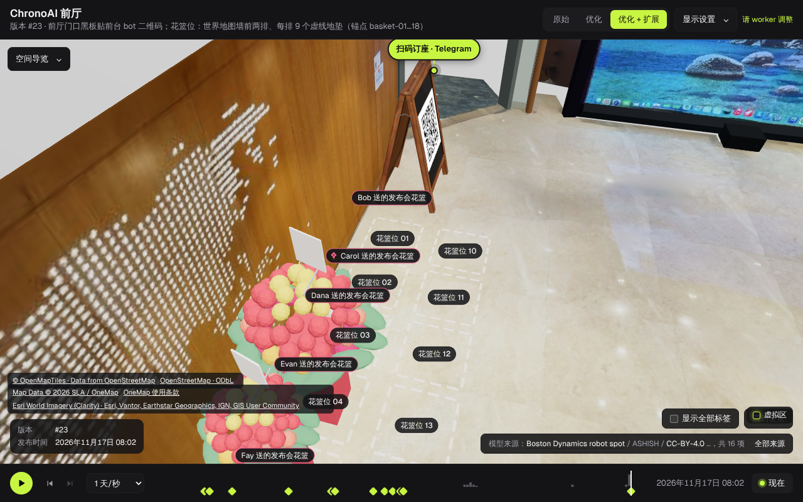
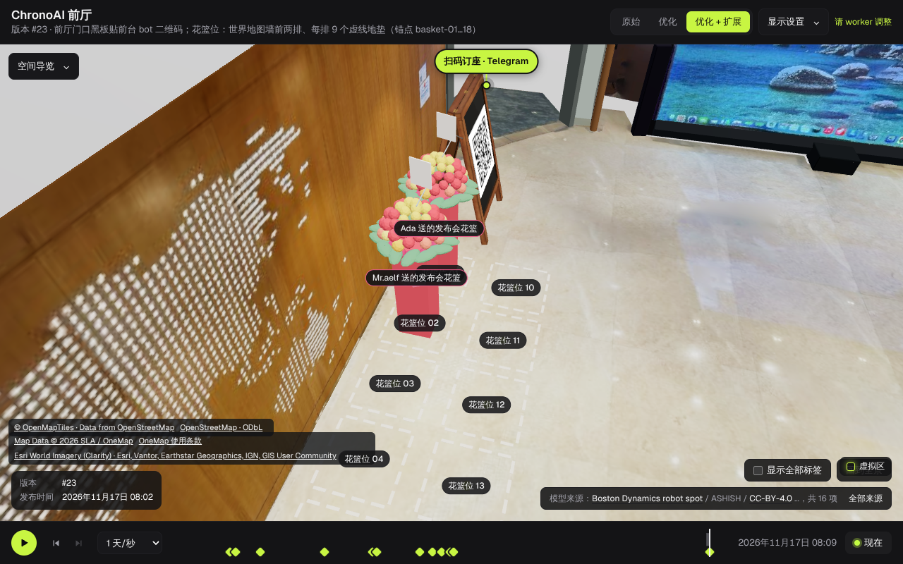

# 第四章 街角前厅：一座自己运转的虚拟会场

如果一家公司站在台上拍胸脯说「我们的 AI 员工可以替你守前台」，自己办发布会却租了一间五星级酒店宴会厅、雇了一排穿西装的人类礼仪递话筒——任何眼神毒辣的怀疑论者都会笑出声，而前排的实验物理学家会直接举手拆台：「既然你们的机器这么稳，怎么不让它自己把门口的椅子摆好？」

于是我们把酒店退了，把摄制组省了，直接拿自家的三维空间引擎 `chrono-metaverse` 搭起一座全天候开放的线上发布会前厅：**街角前厅（`street-corner`）**。

推开这扇门有两条干净入口：公开只读观景页 `/u/street-corner?view=extended`（直接看空间与舞台）或经由开放注册的 **`NyxID` 一键登录**进入交互工作区（`invite_code_required: false`，支持 GitHub / Google / Apple；若只想看直播，YouTube `@ChronoAIOfficial` 与 LinkedIn Live 全程免登录）。正式订座则直连 Telegram 礼宾机器人 **`@chronoai_frontdesk_bot`**（网页自助订座与电话专线仍列在开播前待办项里，绝不提前充数）。

步入广场，你撞见的不是一张冷冰冰的报名表单，而是一座按真实坐标建出来的三维舞台：正前方是 AI 礼宾 **Donna** 值守的发光前台；沿世界地图墙一侧排开 **花店（Flower Town）**的 **2 排 × 9 块花篮垫位（`basket-01` 至 `basket-18`）**，由助手 **小花（Blossom）** 与 Telegram 下单入口 **`@flowerassis_bot`** 看管；而在广场背后升起的「星潮」虚拟剧场里，不是什么拍脑袋画出来的同心圆，而是经 `chronoai-lobby`（v40）座位总账精确编号的**四座阶梯看台 × 八级台阶 = 1,108 个实名可锁席位**：

- **按看台拆分**：北看台 **248** 席、南看台 **248** 席、东看台 **306** 席、西看台 **306** 席（$248 + 248 + 306 + 306 = 1{,}108$）。
- **按第 1 至第 8 级台阶拆分**：依次为 **144、144、144、140、136、136、132、132** 席（合计 **1,108** 席）。
- **真实座位编码**：每一张椅子都有唯一坐标码（如 `N1-17`、`E1-20`、`W8-01`），直播事件到达后约 **55–81 秒**即可在三维空间里点亮或释放对应席位。

更有野心的东西藏在镜头拉远之后：`chrono-metaverse`（`dev 21e1f93`，2026-11-27）为这场发布会准备了一套**四级延伸转播管线**——画面从新加坡办公室里的实体机柜屏（`rb.cabinet-01`）出发，放大到 `1,108` 席的星潮虚拟体育场，再拉升到新加坡滨海湾金沙上空 **`252.8 m × 142.2 m`** 的空中巨幕，最终推向地球近地轨道 **`5,307 km × 2,985 km`** 的行星级银幕。尺度可以拉到轨道，但脚底的每一把椅子必须锁得像瑞士表一样准。

## 五步确定性状态机：为什么两个浏览器抢不走同一个 `N1-17`

把真实发布会搬进三维会场，真正要命的从来不是灯光好不好看，而是**高并发下的状态一致性**。当数百位观众在开场前十分钟涌进来抢座位，什么东西保证 `N1-17` 不会被两个浏览器同时签下？什么东西保证第 1,109 位来宾不会对着白屏 500 报错发愣？

这里有一个最诚实的厨房工作台故事：早先测试时，一份 `750` 行级别的普通电子表格座位台账在并发压力下直接卡断了——于是我们在开播前把它砸碎重写，换成了紧凑的位图索引结构（`sheet-v3`）与原子锁状态机。整条来宾动线收敛为五步：打开前厅或 `@chronoai_frontdesk_bot`、完成零密钥 `NyxID` 签入、由礼宾 **Donna** 核对需求、触发带原子锁的四看台选座或花篮落位，最终在 16:00 SGT 切入直播主舞台。

::: {.figure src="ch04-street-corner-flow"}
**街角前厅五步来宾动线与原子锁流程。** 来宾经前厅与 `NyxID` 签入（或通过 `@chronoai_frontdesk_bot` 预约）后，由 Donna 接待并分流至四看台八级阶梯剧场原子选座（1,108 席上限）与花店（Flower Town）祝贺花篮垫位（2 排 × 9 块，共 18 槽），切入 16:00 SGT 直播主舞台。
:::

与其让你凭空相信这套锁扛得住，下面这台客户端确定性交互实验台 `LAUNCH//ARENA` 把四座看台八级台阶（北 248、南 248、东 306、西 306，合计 `1,108` 席）与世界地图墙边的 `18` 块花篮垫位全部摊到平面上。先看尚未开闸的空场骨架：

::: {.viz src="launch-arena" preset="lobby" height="500"}
**街角全貌（`lobby`）。** 尚未开闸的 `street-corner` 围合碗形布局：四座悬浮玻璃阶梯看台（北 `248`、南 `248`、东 `306`、西 `306`，共八级台阶 `1,108` 个待预约席位）从四面环抱中庭碗池；碗池内部依次落位北侧主旨银幕、西侧 Donna 接待台、东侧花店（Flower Town），以及沿南侧世界地图墙排开的 `2 × 9` 块花篮垫位（`basket-01..18`）。
:::

现在拉闸放客。下面的 `booking` 实验卡演示开场客流涌入前排阶梯席位并并发落锁的过程——盯紧底部的冲突计数器：在原子选座锁的不变量约束下，**模型中的重座碰撞数始终保持 `0`**，每一个确认码与唯一座位编号（如 `N1-17`、`E1-20`）严格一一对应，这也是 12 月 11 日正式压测的硬门槛。

::: {.viz src="launch-arena" preset="booking" height="500"}
**原子选座锁（`booking`）。** 模拟 `N = 720` 位来宾进场并暂停于开场前 `T−30`（第 `45` 分钟）：四座看台第 `1–3` 排共 **`432` 个席位（`144 × 3`）** 干净填满并逐一青色落锁，第 `4` 排仍保持空置，重座碰撞数恒为 `0`。
:::

接着是所有运营最怕、却最能试出诚实度的极限场景：**如果涌来 1,250 位来宾，撞穿了 1,108 席上限怎么办？** 许多花哨的虚拟空间要么当场崩服，要么偷偷把后来的虚拟形象叠在别人脑门上。我们的策略像物理开关一样干脆：第 1 至第 1,108 号实名席位死死锁在四座看台内，从第 1,109 位来宾起，Donna 当场给出清晰的满座告示，并直接把人引向免登录的 YouTube（`@ChronoAIOfficial`）与 LinkedIn Live 高清同步流——在下面的 `overflow` 实验卡与 12-11 压测标准里，**硬指标是零重座冲突、零滞留报错**。

::: {.viz src="launch-arena" preset="overflow" height="500"}
**满座溢流保护（`overflow`）。** 当到场客流升至 1,250 人、触及 1,108 席硬上限时，四座看台内全部席位保持零冲突锁定，超出的 142 位来宾被清晰路由至 YouTube 与 LinkedIn Live 同步直播通道。
:::

## 世界地图墙下的花店：小花与十八块花篮垫位

如果四座看台代表秩序与原子锁，那么世界地图墙边那排 **2 排 × 9 块（每块 `0.6 × 0.6 m`）的祝贺花篮垫位（`basket-01` 至 `basket-18`）**，就是这座由智能体值守的会场里最鲜活的人气。亚洲的开业与发布会讲究朋友与同行送来祝贺花篮；我们没有拿静态贴图糊弄，而是把花篮做成真实可写入的三维空间对象。

来宾或合作伙伴只需在 Telegram 找到花店机器人 **`@flowerassis_bot`**，由 **小花（Blossom）** 协助选花、写下署名贺卡，经由 Donna 核验并触发 `chrono-metaverse` 空间写入，**端到端约 2.5 分钟**后，那只带着贺卡铭牌的独一无二三维花篮就会实时落位在指定垫位上，供每一位步入会场的观众亲眼看见。

下面的 `basket` 实验卡展示了 18 块垫位的典型落位状态——其中 12 座已点亮展示祝贺花篮，6 块以琥珀色空位等待认领。每一只花篮从一句聊天到三维落位，穿过的都是同一辆五层整车：`NyxID` 作用域门卡、`NyxBot` 专项工作流与 `chrono-metaverse` 空间写协议。

::: {.viz src="launch-arena" preset="basket" height="500"}
**十八块花篮垫位（`basket`）。** 聚焦世界地图墙边 2 排 × 9 块编号花篮垫位（`basket-01..18`，示例 12 座已点亮、6 座空缺待领），演示贺卡经 `@flowerassis_bot` 与小花核验后物化进三维前厅的过程。
:::

## 六十一秒穿行街角前厅

文字和平面图之外，下面这部六十一秒（1:01）短片把「从一束花到一个席位」压缩成一气呵成的镜头语言——从推开街角大门、听 Donna 接待、看四座看台的 `1,108` 个席位逐一落锁，到十八只花篮沿墙次第亮起。

::: {.film src="from-flower-to-seat"}
**从一束花到一个席位（会场导览短片）。** 61 秒（1:01）完整走完 `street-corner` 三维虚拟会场：Donna 前台核验、1,108 席四看台原子锁、满座直播分流与 Flower Town 18 块花篮垫位落位。
:::

## 11 月 27 日真刀真枪彩排：11/12 过关，以及那次 65 分钟的真实卡顿

纸上讲护栏谁都会讲，真正见功夫的是彩排把系统逼出汗。

截至 **2026 年 11 月 27 日**（`nyxid-nyxbot-trials@df5ef47`），**Donna** 的礼宾流程实测已从两天前的 `13/15` 推进到 **`14/15`（`93.3%`）**——开场签到提醒当天跑通，只剩电话专线（`con-14`）诚实留作待办；而在第四卷第四章锁死的**三十题官方记者问答库**（12 月 16 日 Discord 正式总彩排前灌入生产表），更定下了一条比「什么都答」值钱十倍的铁律：**凡超出核验边界的追问（融资、未定排期、夸大结论），一律拒绝编造，当场记单转交 `contact@chrono-ai.fun`。**

同日，我们用真实机器人把发布会全部 **12 个环节**端到端拉通演练了一遍（`trials#225`/`#226`）：

- **11 / 12 环节一次跑通**，全程人类总控只亲手做了 **`4` 次动作**（扮演一次来宾、索取一份主持人问答清单、回一句 `"发 149"` 放行一条 X 贴文、确认回放就绪）；
- **实测响应延迟**：Donna 完成 `13` 次订座与签到操作，**`0` 条丢单**，中位耗时 **`29 秒`**（最长 `63 秒`）；Discord 问答 **`56–76 秒`**；定时提醒误差 **`46–49 秒`**；
- **唯一翻车的那 1 关，我们一字不遮地端给你看**：Lark 内部群拉取主持人问答清单时，请求在网关队列里整整卡死 **`65–70 分钟`**（缺陷单 **`NyxID#2534`**）——值守链路没有干等，立刻改由一次性定时任务绕行，**`3.0 分钟`**把七大主题的主持人手卡干净送到桌面。

敢把卡顿单号和绕行秒数印进主书的会场，才经得起全球直播。拉动下面这台完整的 `LAUNCH//ARENA` 实验台，把并发客流从 `1` 推到 `1,250`，自己点开每一座看台和每一块花篮垫位，给我们的街角前厅做一次不留情面的体检。

::: {.viz src="launch-arena" height="560"}
**完整实验室：`LAUNCH//ARENA`。** 自由调节并发到场人数（1–1,250）、切换五张实验卡、点击四座看台或 18 块花篮垫位，实时观察原子选座锁与直播溢流分流曲线。
:::

入席坐定，场灯暗下。大银幕打出的第一束光，不对准任何商业口号，而是打向一个比软件市场更冷酷、比记者会更不容蒙混的试车场——**纯粹数学与 Lean 4 编译器内核**。下一章，抬头看我们的北极星。
