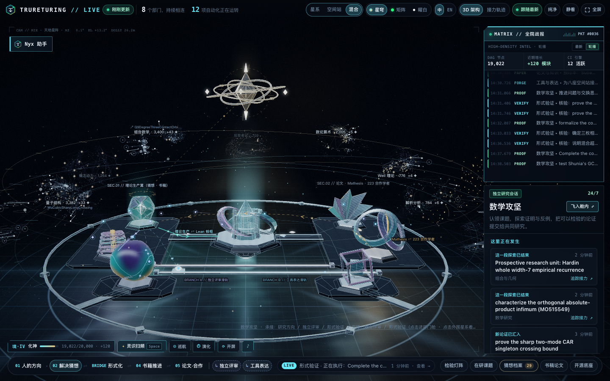
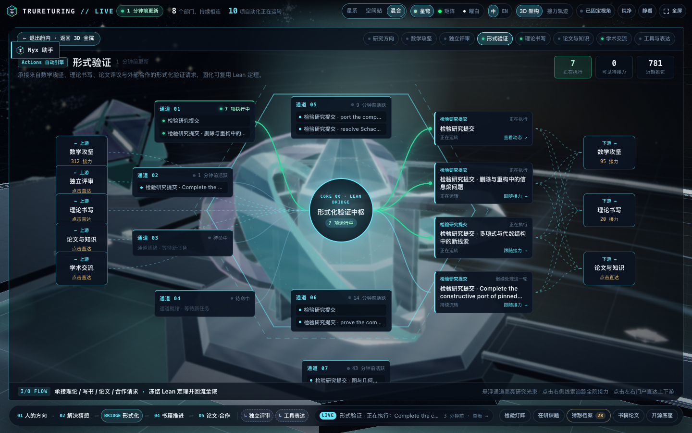

# Chapter 5: Inside live.trureturing.org—An Eight-Department Glass Observatory

Most research labs present their work like a pastry shop that puts gleaming cakes in the window while bolting the kitchen door with deadbolts. You are welcome to admire the frosting; you are never allowed to check the flour, count the cracked bowls, or see what is currently burning in the oven.

**`https://live.trureturing.org/`** smashes the kitchen wall and replaces it with 360-degree glass.

Open the live observatory and you do not face a six-month-old static poster. You step into a live holographic constellation wired directly to the underlying public repositories. As captured on November 27, 2026, the observatory tracks **19,022 live truth-DAG nodes** across **8 distinct research departments** and **17 public GitHub repositories**, accompanied by an embedded assistant so any visiting researcher can interrogate a theorem's lineage on the spot.

## How Eight Glass Departments Lock Together

Flatten the 3D observatory into an architectural map and you see immediately why a 24/7 formal research engine does not degenerate into tangled spaghetti—it is organized like a real institute into eight cleanly scoped departments:

::: {.figure src="ch05-eight-dept-observatory"}
**Architecture of the Eight-Department Glass Observatory (`live.trureturing.org`, November 27, 2026 snapshot).** Top row links `17` public repositories into `19,022` DAG nodes; center cards list all eight departments (Formal Verification Core, Theory Architecture, Open Problem Hunting, Quantum & Foundations, Number Theory & Zeros, Combinatorics & OEIS, Outreach & Monographs, Governance & StrataLint); footer notes unbroken `720 / 720` UTC hourly commit coverage (median `59` commits/hour).
:::

Step inside one department—such as **Formal Verification Core** captured live below—and the glass reveals active freezing pipelines, dependency topology, axiom audits, and newly landed modules in real time:

## 720 Continuous Hours of Industrial Research Cadence

Inspect the raw repository telemetry standing behind the glass (verified snapshots from `the-omega-institute/trureturing`, November 19–20, 2026):

| Telemetry Axis | Exact Reading | Window & Scope |
| --- | --- | --- |
| Frozen Theorems | `167,819` | `kind = theorem` across `Golden/Frozen/state/D5/*.json` (2026-11-20) |
| Frozen Modules & LOC | `14,701` frozen modules / `16,278` `.lean` files / `4,775,059` LOC (`4.78M`) | Lean `4.35.0` toolchain (2026-11-20) |
| Continuous Hourly Coverage | `720 / 720` UTC hours (`100.0%`) | 2026-10-21 through 2026-11-19 across all branches |
| Commit Median & Hourly Band | Median `59` commits/hour; UTC clock-hour totals `1,514`–`2,212` | Same 720-hour window |
| Daily Merged PR Throughput | `159` merged PRs/day (`1,110` over last 7 full UTC days) | `dev` branch (as of 2026-11-19) |
| Static Governance (`StrataLint`) | `28` registered rules, `24` active | `tools/StrataLint.Engine` (2026-11-20) |

Pay particular attention to the bottom row: **`StrataLint`**. Just as `chrono-harness` governs our engineering repositories (Volume II), `trureturing` survives 59 commits per hour for 720 straight hours not by magic, but through 24 active static governance rules bolted onto the Lean 4 kernel gate:

- Zero undeclared axioms may smuggle into frozen theorems;
- Zero `sorry` placeholders pass merge validation;
- Every frozen declaration records its name key, kind, module `statement_id` digest, and (on newly audited modules) standard-axiom closure in `Golden/Frozen/state/<module>.lean.json`, while `trureturing.lock.json` resolves exact source line numbers and signatures;
- Whenever an upstream module shifts, `trureturing.lock.json` and `./tbook check` immediately flag statement-summary drift so book prose can never quietly detach from kernel reality.

## Why a Glass House Outruns a Black Box

People often ask a pragmatic question: *"By publishing 17 repositories, 19,022 live nodes, and every single Lean file in real time, aren't you handing away your secret sauce?"*

The honest answer is blunt: what stops most teams is never a hidden recipe written on a napkin—it is **willingness to face ruthless, instant correction every hour of the day.** Operating inside a glass observatory compounds faster than any closed vault:

1. **Working scholars become your sharpest auditors**: The 440 researchers who replied across 273 institutions and 46 countries (as of November 8, 2026) engaged seriously—with our October 31, 2026 novelty audit across 1,108 incoming messages transparently recording `1.5%` prior settled overlap and `1.6%` partial overlap (no prior-art objection raised on the remaining ~`96.9%`)—and public source lets every claim resolve straight to checkable Lean files for independent scrutiny.
2. **Real progress stays visibly separated from theater**: Inside a glass house, nobody can quietly repackage an unfinished heuristic as a proved theorem when every node's frozen badge and red open status update in public view.

Once thousands of theorems live safely in `.lean` files, the next question is human readability and reproducible verification at scale: how do raw proof files become open papers, bilingual monographs, and independently replayable mathematical artifacts? Chapter 6 visits **Mathesis**, **`books.trureturing.org`**, and the **8,490-shard Riemann Hypothesis replay book**.
