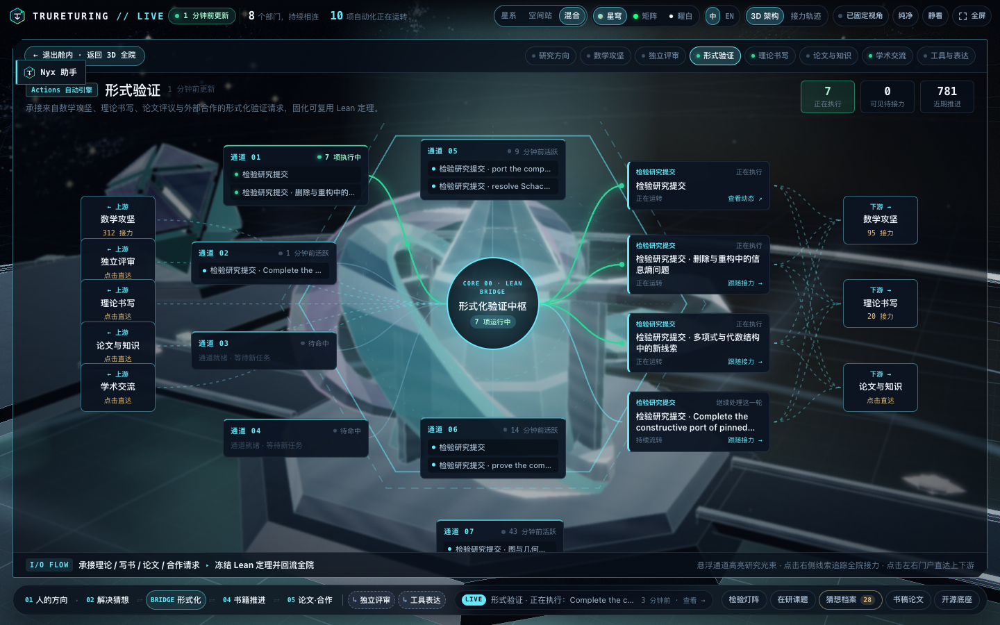

---
# 01 封面
theme: ../../../../theme/slides
title: "逻辑的棘轮 · 科研成果展示"
info: "The Omega Institute 科研成果展示：FIB ATOM、信息逃逸、强制几何、文献前沿与红色边界。"
htmlAttrs:
  lang: "zh-CN"
  data-polarity: "deep-space"
deck:
  code: "OMEGA//TRUTH"
  book: "逻辑的棘轮"
  title: "科研成果展示"
  version: "0.1.0"
  blurb: "四大数学奇观、Lean 4 冻结定理与诚实的红色边界：16 页科研精粹。"
layout: cover
preloadImages: false
---

The Omega Institute · trureturing 与开放数学前沿

<h1 class="display">逻辑的<em>棘轮</em></h1>

散文能把漏洞藏上几十年；Lean 4 内核一步也不放过。

---
# 02 尺度
section: "尺度"
---

  
只进不退

  <h2 class="t">棘轮只朝<em>一个方向</em>转</h2>
  

    <Stat value="223,231" label="冻结 Lean 4 定理（冻结声明共 400,377）" tone="ok" />
    <Stat value="17,968" label="冻结模块 · 602 万行 Lean 源码" />
    <Stat class="mt" value="720/720" label="连续 UTC 小时有提交 · 中位每小时 63 次 · 日均合入 217 PR" tone="magenta" />
    <Stat class="mt" value="2,278" label="道公开文献题解 · 81 天" />
  

  
三部双语专著 trureturing-books：344 双语页 · 135 个交互实验 · 83 部短片 · 918 定理块 / 2,043 独立冻结 GID

  
同一页记下红字：Mathesis 收录 225 篇附源码论文，经 Mathesis 审稿流程录用 <b class="hl-warn">0</b> 篇（11-27）

<Source>trureturing@548388cd（2026-11-27）· 节律 10-28 至 11-26 · PR 口径 11-20 至 11-26 · trureturing-books@b83ae321（11-28）· Lean 4.35.0</Source>

---
# 03 奇观一
layout: section
chapter: "01"
section: "奇观一 · FIB ATOM"
---

第一篇 · FIB ATOM

<h2 class="t">外表完全一样， <em>血统彻底分离</em></h2>

替换规则 <Tex t="\alpha \mapsto \beta,\ \beta \mapsto \beta\alpha" />： 边界读数分毫不差，血统分布却与均匀分布渐近奇异。

---
# 04 FIB ATOM
section: "FIB ATOM"
---

  
定理 1.2 · 定理 1.4

  <h2 class="t">黄金进位亏量只取<em>三值</em>，血统却<em>一代就分家</em></h2>
  

    

      
<TheoremCard class="compact mt" label="定理1.2" title="黄金进位亏量只取三个值" gid="D5/S1/Deficit/DeficitThreeValued.deficit_three_valued" cite="thm-fib-deficit">

对所有自然数 $v_1, v_2$：$c(v_1, v_2) \in \{-1,\ 0,\ 1\}$。

</TheoremCard>
    

<TheoremCard class="compact" label="定理1.4" title="有序源纤维与单射斐波那契血统输运" gid="D5/S3/Arith/FibonacciAtomic/GenealogicalFiberTransport.result" cite="thm-fib-lineage">

对所有 $1 \le a + b$：同一源纤维里的每棵树，替换后边界组成完全相同；输运映射是单射，推前分布与目标纤维均匀分布的全变差精确为 $\mathrm{TV}(a, b, n) = 1 - \mathrm{fiberCount}(a, b) / \mathrm{fiberCount}(\mathrm{step}^{[n]}(a, b))$，且 $\mathrm{TV}(a, b, n) \to 1$（$n \to \infty$）。当 $2 \le a + b$ 时，一代即有下界 $1 - 2^{-b} \le \mathrm{TV}(a, b, 1)$；最小例子

$$\mathrm{TV}(1, 1, 1) = \tfrac{2}{3}.$$

</TheoremCard>
  

<Source>D5/S1/Deficit · D5/S3/Arith/FibonacciAtomic · 第三卷第一章</Source>

---
# 05 奇观二
layout: section
chapter: "02"
section: "奇观二 · 信息逃逸"
---

第二篇 · 信息逃逸 · 直觉类比

<h2 class="t">同一块金子， <em>挖不了两次</em></h2>

这是可恢复性的直觉：一条新定理，只有分辨出旧目录分不开的状态，才算真正的新信息。精确陈述见下页 Lean 定理。

---
# 06 信息逃逸
section: "信息逃逸"
---

  
定理 2.3 · 定理 2.5

  <h2 class="t">换一千种写法复述旧定理，<em>盲区一毫米也不收缩</em></h2>
  

    
    

<TheoremCard class="compact" label="定理2.3" title="降低逃逸当且仅当落在留一语义闭包之外" gid="D5/S3/ConceptDynamics/InformationEscape/StructuralNovelty.lowersEscape_iff_not_mem_semanticClosureWithout" cite="thm-ie-closure">

设竞技场非退化。条目 `index` 严格降低信息逃逸率，当且仅当它的分辨核不属于其余条目的语义闭包。

</TheoremCard>
<TheoremCard class="compact mt-s" label="定理2.5" title="同核的两条不同条目独占捕获皆为零" gid="D5/S3/ConceptDynamics/InformationEscape/StructuralNovelty.same_kernel_both_zero" cite="thm-ie-same-kernel">

若两条不同条目对所有状态对诱导完全相同的一致关系，则两者的独占捕获数同时为零。

</TheoremCard>
    

  

<Source>标题为直觉类比，卡片为 Lean 定理原意 · D5/S3/ConceptDynamics/InformationEscape/StructuralNovelty · 第三卷第二章</Source>

---
# 07 奇观三
layout: section
chapter: "03"
section: "奇观三 · 强制几何"
---

第三篇 · 强制几何

<h2 class="t">不预先假设复数与三维， <em>逻辑会把它们硬逼出来吗？</em></h2>

只保留可观测纤维、三向配平律与紧致倒易约束，看数学还有没有别的选择。

---
# 08 五模坐标
section: "五模坐标"
---

  
定理 3.1

  <h2 class="t">看得见的是金字塔，<em>藏起来的是一条 Fisher 纤维</em></h2>
  

    
<TheoremCard class="compact" label="定理3.1" title="五模可见占据与隐藏对数交叉比的全局 Fisher 坐标卡" gid="D5/S1/Words/AdmissibleWords/FiveModeMixedCoordinates.mixed_coordinates_global_chart" cite="thm-five-mode-chart">

在五模开放概率单纯形上：对金字塔内任意可见点 $v$ 与任意实数 $c$，存在**唯一**正概率律 $p$ 使 $\mathrm{visible}(p) = v$ 且 $\mathrm{hiddenChi}(p) = c$。

隐藏坐标的方向导数恰为 Fisher 配对；隐藏方向和为零，且在可见坐标下完全消失。

</TheoremCard>
  

<Source>D5/S1/Words/AdmissibleWords/FiveModeMixedCoordinates · 第三卷第三章</Source>

---
# 09 刚性定理
section: "刚性定理"
---

  
定理 3.2 · 定理 3.3

  <h2 class="t">配平律迫出<em>复希尔伯特空间</em>，倒易律迫出<em>三维</em></h2>
  

<TheoremCard class="compact" label="定理3.2" title="原始配平律的完整复希尔伯特空间刻画" gid="D5/S3/Quantum/Completion/RawAnchoredRadicalDescent.raw_hilbert_characterization" cite="thm-raw-hilbert">

设 $M$ 为带单位元的乘性广群，$U(1) = 1$，$\omega = (-1 + i\sqrt{3})/2$；原始配平律 `RawBalance` 含非负性 $c \ge 0$、零对角 $c(a, a) = 0$ 与三向配平。它成立当且仅当存在最小复希尔伯特表示；任何满足 $F(ab) = F(a) + F(b)$、$F(Ua) = \omega F(a)$ 与 $c(a, b) = \|F(a) - F(b)\|^2$ 的映射都迫使配平律成立；配平律成立时，任意两个最小表示 $S, T$ 之间存在**唯一**保标签复线性等距同构 $e$（$\forall a,\ e(S.\mathrm{label}\,a) = T.\mathrm{label}\,a$）。

</TheoremCard>
<TheoremCard class="compact" label="定理3.3" title="紧致完全倒易律迫出三维空间与完整正交李代数" gid="D5/S3/Quantum/Algebra/OriginalCompactReciprocity.original_rigidity" cite="thm-rigidity-3d">

设 $W$ 为有限维实内积空间，$G \le (W \to_L[\mathbb{R}] W)^\times$ 为紧致子群，$A \in \mathrm{OriginalLie}\,G$ 非零，$x \neq 0$，$Ax = 0$，且满足完全倒易律。则存在 $G$-不变内积 $B$，使

$$\dim_{\mathbb{R}} W = 3 = \dim_{\mathbb{R}} \mathrm{OriginalLie}\,G,$$

且作用像恰为 $B$ 的全部反对称自同态，即 $\mathfrak{so}(3)$。

</TheoremCard>
  

<Source>D5/S3/Quantum/Completion · D5/S3/Quantum/Algebra · 第三卷第三章</Source>

---
# 10 奇观四
layout: section
chapter: "04"
section: "奇观四 · 文献前沿"
---

第四篇 · 文献前沿

<h2 class="t">冲进公开文献的真实悬案： <em>81 天，2,278 题</em></h2>

不做自己出的考题——直接跳进学者们写在论文末尾的 Open Problem。

---
# 11 文献分布
section: "文献分布"
---

  
2026-09-08 → 2026-11-27

  <h2 class="t">2,278 道题解：<em>1,512 证明</em>，<em class="magenta">766 反驳</em></h2>
  

    
    

      <Stat class="md" value="684" label="道出自同行评审期刊 · 另有 arXiv 840、OEIS 729" />
      <Stat class="md mt" value="127" label="道悬置逾十年，最久 47 年" tone="magenta" />
      <Stat class="md mt" value="598" label="道出自量子信息与理论物理（314 证 · 284 反）" />
    

  

<Source>trureturing@548388cd（2026-11-27）· 2,276 带日期 + 2 未标日期 = 2,278</Source>

---
# 12 代表证明
section: "代表证明"
---

  
原题出处 · Phys. Lett. A 2000 · Phys. Rev. A 2012

  <h2 class="t">悬置 26 年的熵界，<em>对一切 K 成立的面片</em></h2>
  

<TheoremCard class="compact" label="定理4.2" title="Higuchi–Sudbery 四量子比特平均两比特熵精确上界" gid="D5/S3/Quantum/Entanglement/HiguchiSudbery/HiguchiSudberyEntropyMaximum.result" cite="thm-higuchi-sudbery">

对所有归一化四量子比特纯态 $z \in \mathbb{C}^{16}$，三个两比特切口（AB、AC、AD）的平均冯诺依曼熵满足

$$\mathrm{averageEntropy}(z) \le 1 + \tfrac{1}{2}\log_2 3,$$

显式态 $M_4$ 精确取到等号。

</TheoremCard>
<TheoremCard class="compact" label="定理4.3" title="三方 Mermin–CGLMP 不等式对所有 K≥2 都是局域多面体的面片" gid="D5/S3/QuantumBounds/MerminCglmpFacet.result" cite="thm-mermin-facet">

对任意整数 $K \ge 2$：三方局域多面体 $L_K$ 中所有行为满足

$$(K - 1) \le I_K(p),$$

且饱和面在 $L_K$ 中的余维数恰为 $1$——它是面片（facet）。

</TheoremCard>
  

<Source>D5/S3/Quantum/Entanglement · D5/S3/QuantumBounds · 第三卷第四章</Source>

---
# 13 代表反驳
section: "代表反驳"
---

  
原题出处 · Phys. Rev. A 2025 · Nat. Commun. 2021

  <h2 class="t">两个公开猜想，<em class="magenta">两枚内核反例</em></h2>
  

<TheoremCard class="compact" label="定理4.1" title="Fredkin 门纠缠能力猜想的反驳" gid="D5/S3/Quantum/Entanglement/FredkinEntanglingPowerRefutation.result" cite="thm-fredkin-refutation">

Qiu–Song–Chen 关于四量子比特 Fredkin 门跨 `AD:BC` 切口、带局域辅助比特的纠缠能力上确界等于 $2$ ebits 的猜想不成立：$\neg\,\mathrm{claim}$。

证明中的见证（不在陈述中）：约 2.00034… ebits。

</TheoremCard>
<TheoremCard class="compact" label="定理4.6" title="d=4 的相容通道未必 Jordan 相容" gid="D5/S3/QuantumChannels/JordanCompatibilityRefutation.result" cite="thm-jordan-refutation">

「一切维度中的一切相容量子通道对都 Jordan 相容」不成立：$\neg\,\mathrm{claim}$，在 $d = 4$ 有显式通道反例。

</TheoremCard>
  

  

    <LeanBadge gid="D5/S3/Quantum/Dynamics/AverageMixingDiscriminantIntegrality.result" /> Godsil 判别式整性 · <i>JCTA</i> 2013
    <LeanBadge gid="D5/S3/Divergence/CoherenceL1RelativeEntropyBound.result" /> Rana 相干度界 · <i>PRA</i> 2016
    <LeanBadge gid="D5/S3/Quantum/Algebra/ZeitlinSixJ/RicciLimit.result" /> Zeitlin Ricci 极限 · <i>CMP</i> 2026
  

<Source>D5/S3/Quantum · D5/S3/QuantumChannels · D5/S3/Divergence · 第三卷第四章</Source>

---
# 14 观测站
section: "观测站"
---

  
实时观测站 · live.trureturing.org

  <h2 class="t">八个部门，<em>一座玻璃房</em></h2>
  

    
    

      <Stat value="19,022" label="实时真理节点 · 8 座螺旋星系 · 17 个公开仓库" />
      <ul class="plain mt tight">
        <li><b>八个职能部门，不按学科分</b> 研究方向 · 数学攻坚 · 独立评审 · 形式验证 · 理论书写 · 论文与知识 · 学术交流 · 工具与表达</li>
        <li class="mt-s"><b>1,049 位学者联络，485 位回信</b> 1 篇 <i>RAIRO-ITA</i> 论文 · 17 篇合作 arXiv 预印本 · 21 条 OEIS；66 位婉拒</li>
        <li class="mt-s"><b>StrataLint：23 条现役 / 27 条登记</b> 已迁入 trureturing-tools，与 Lean 4 内核组成双重门禁</li>
      </ul>
    

  

<Source>live.trureturing.org（2026-11-27）· trureturing-outreach@d22e63c8（11-27，回信率 46.2%）· trureturing-tools</Source>

---
# 15 红色边界
section: "红色边界"
---

  
定理 6.3 · 外部认证 · 开放问题

  <h2 class="t">等价归我们，证明归外部，<em class="warn">红区在更远处</em></h2>
  

    
    

<TheoremCard class="compact" label="定理6.3" title="黎曼猜想与真实 ξ 整系数 Hankel 非负性的等价判据" gid="D5/S3/Zeros/Resolvent/ActualXiIntegerCriterion.rh_iff_actual_xi_integer_hankel_nonnegative" cite="thm-rh-hankel">

$\mathrm{RiemannHypothesis}$ 成立，当且仅当对一切阶数 $N$ 与一切 $u : \mathrm{Fin}\,(N+1) \to \mathbb{Z}$，真实 $\xi$ 系数的 Hankel 二次型非负。本定理只断言等价，不断言任何一端成立。

</TheoremCard>
<TheoremCard class="compact mt-s" label="开放问题6.4" title="古典黎曼猜想之后的开放前沿：Dedekind ERH、Grand RH、零点简单性与对关联" status="open" cite="prob-rh-open">

Dedekind $\zeta$ 的扩展 RH、自守 $L$ 函数的大 RH、零点单重与对关联：<b>依然开放。</b>

</TheoremCard>
      
经典 RH 与 Dirichlet GRH：Levent Alpöge 的外部 Lean 4 证明，11-20/21 获社区认证；本所只做 8,490 分片重放。

    

  

<Source>ActualXiIntegerCriterion · riemann-hypothesis@c2dabc97 · riemann-hypothesis-book@ebd24a4d（11-27）· 第三卷第六章</Source>

---
# 16 结尾
layout: cover
---

亲手重放

<h1 class="display">五步核验， 亲自用 <em>Lean 4</em> 复验</h1>

live.trureturing.org

github.com/the-omega-institute/trureturing @ <PinnedCommit />

