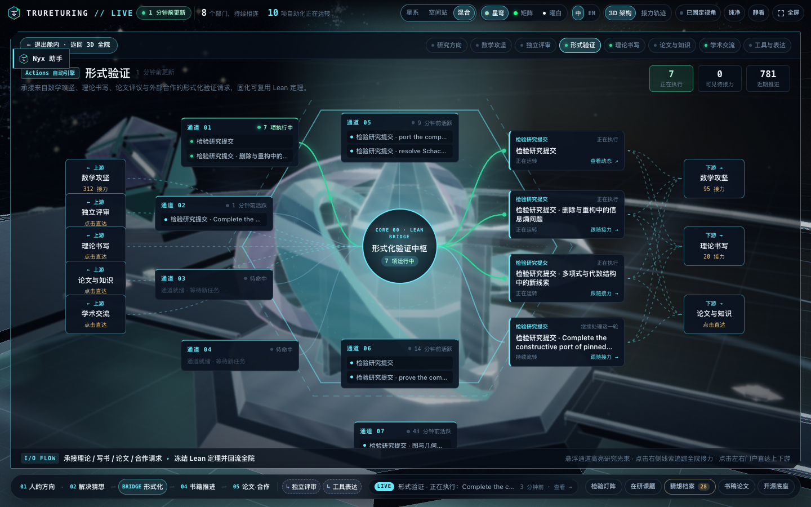

# 第五章 走进 live.trureturing.org：八部门透明玻璃观测站

多数科研机构对外示人的方式，像一家把裱花蛋糕摆进橱窗、却拿铁栓锁死厨房门的甜品店（**类比**）。你可以隔着玻璃赞美奶油有多光滑，却永远看不见后厨用了什么面粉、砸碎过几只瓷碗，也看不见炉火上此刻正焦着哪一盘。

**`https://live.trureturing.org/`** 一锤砸开后厨砖墙，换成了三百六十度透明玻璃。

推门走进这座全息观测站，你面对的不是半年一换的宣传海报，而是直接接通底层公开仓库群的活体真值图谱。截至 2026 年 11 月 27 日实测抓取快照，环绕中央八座空间站旋转的**八座数学螺旋星系**精准映射着 **19,022 个真值节点**（总计 **36,865 个节点**、**28,774 条有向边**）、**8 个职责分明的功能流水线部门**与 **17 个持续追踪的公开 GitHub 仓库**；左上角的实时语音导览 **Alexandra**（由 `nyx-assistant-sdk v0.2.4` 驱动，支持语音播报、实时截屏与中英双语站点导览）可直接带着来访数学家穿梭八座空间站与八座星系，右侧实时战报面板同步滚动正在执行的验证接力。

## 八个玻璃部门如何咬合运转

把三维全息空间站摊平到纸面上，你会立刻明白为什么一台 24/7 不停机的形式化科研引擎没有塌成一团意大利面——它不是按传统院系的学科壁垒切蛋糕，而是按一条从选题、攻坚、独立拷问到形式化冻结与公开出版的**八站功能流水线**严密咬合：

1. **研究方向（`Direction`）**：锚定开放前沿、收敛研究路线与任务优先级；
2. **数学攻坚（`Math Research`）**：认领公开猜想与内部核心命题，推进正面证明或反例构造；
3. **独立评审（`Indep. Review`）**：专职唱反调与独立审计，挑刺隐含假设、先例重叠与表述漂移；
4. **形式验证（`Verification`）**：全院的 `CORE 00 · LEAN BRIDGE` 形式化验证中枢，承接上游全部验证请求并把通过 Lean 4 内核编译的定理冻结回流全院；
5. **理论书写（`Monographs`）**：将零散冻结引理织入双语专著的逻辑脊梁；
6. **论文与知识（`Papers & Wiki`）**：持续维护 `Mathesis` 公开论文与结构化知识脉络；
7. **学术交流（`Scholar Outreach`）**：直面全球学者通信、合作撰写与 OEIS 社区提交；
8. **工具与表达（`Tools & Studio`）**：维护编译器治理规则、静态图、交互实验室与科普短片流水线。

::: {.figure src="ch05-eight-dept-observatory"}
**`live.trureturing.org` 八部门透明玻璃观测站架构（2026-11-27 快照）。** 顶层汇集 `17` 个公开仓库与 `19,022` 个 DAG 真值节点，中段列出八大真实功能流水线部门（研究方向 `Direction`、数学攻坚 `Math Research`、独立评审 `Indep. Review`、形式验证 `Verification`、理论书写 `Monographs`、论文与知识 `Papers & Wiki`、学术交流 `Scholar Outreach`、工具与表达 `Tools & Studio`），底栏标注连续 `720 / 720` UTC 小时提交覆盖与中位数 `63` 提交/时。
:::

推门飞入最核心的一座透明舱室——下图中实时展开的 **形式验证（`Verification`，即 `CORE 00 · LEAN BRIDGE`）**——玻璃墙立刻把左侧来自数学攻坚、独立评审、理论书写、论文与知识、学术交流五条上游接力通道、中央正在编译的多条并行验证管线，以及右侧回流至全院的冻结定理通道全部摊在阳光下：

## 连续七百二十小时不停歇的工业级科研节律

把观测站背后最硬的仓库实测遥测表拉到黑板前逐行点验（取自 2026 年 11 月 27 日 `the-omega-institute/trureturing@548388cd` 冻结快照及 30 天连续提交审计）：

| 观测维度 | 精确读数 | 统计窗口与口径 |
| --- | --- | --- |
| 冻结定理总数 | `223,231`（总冻结声明 `400,377`；7 天净增 `+33.0%`） | `Golden/Frozen/state/` 中 `kind = theorem`（`548388cd`，2026-11-27；数分钟后 `5f390707` 已推进至 `223,247`） |
| 冻结模块与源码量 | `17,968` 冻结模块 / `20,223` `.lean` 文件 / `6,024,982` 行（`6.02M`） | Lean `4.35.0` 工具链（`548388cd`，2026-11-27） |
| 小时级连续提交覆盖 | `720 / 720` UTC 小时（`100.0%`） | 2026-10-28 至 2026-11-26 全部分支 |
| 提交中位数与波动 | 中位数 `63` 提交/时；按 UTC 钟点汇总介于 `1,573`–`2,448` | 同一 720 小时窗口 |
| PR 日均合入吞吐 | `217` 个合并 PR / 天（近 7 个完整 UTC 日共 `1,517` 个，环比 `+36%`） | 2026-11-20 至 2026-11-26 |
| 静态治理规则（`StrataLint`） | 登记 `27` 条规则，现役启用 `23` 条（`4` 条延后） | 独立托管于 `the-omega-institute/trureturing-tools`（`tools/StrataLint.Engine/Rules/RepositoryRules.cs`） |

盯紧最后一行：**`StrataLint`**。就像第二卷拆解的工程治理套件 `chrono-harness`（现活跃托管于 `https://github.com/chrono-harness/`）一样，`trureturing` 之所以能在连续 720 小时、每小时中位数 63 次提交、日均 217 个合并 PR 的高压节律下纹丝不乱，靠的绝不是什么玄学灵感，而是 **`trureturing-tools` 中 23 条现役静态治理规则加上 Lean 4 编译器内核**构成的双重铁栅栏：

- 不允许任何未声明的公理偷渡进冻结定理；
- 不允许任何 `sorry` 混过合并门禁；
- 每一条冻结声明都写入 `Golden/Frozen/state/<module>.lean.json`，固化其声明键、种类、陈述摘要哈希（`statement_id`）及公理闭包，再由书库 `trureturing.lock.json` 解析精确源码行号与签名；
- 一旦上游模块发生语义漂移，`trureturing.lock.json` 与书库的 `./tbook check` 立刻把摘要变化标红报警，绝不让文字悄悄脱离代码真相。

## 为什么开放玻璃房比「保密黑箱」跑得更远

总有人问一个听上去很精明的问题：「你们把 17 个公开仓库、19,022 个真值节点和六百多万行 Lean 源码实时摊在全世界眼前，不怕别人抄走秘方吗？」

答案冷酷而直白：真正拦住大多数团队的从来不是一张写着秘方的纸条，而是**愿不愿意每天二十四小时把自己的错误摊在阳光下挨打**。在玻璃房里做科学，复利远胜任何密室黑箱：

1. **全球同行直接变成最苛刻的质检员**：截至 2026 年 11 月 27 日，`trureturing-outreach`（`data @ d22e63c8`）已向 **1,049 位**学者发信并收到 **485 位**回复（总体回复率 `46.2%`；剔除系统账号后为 `1,034` 封 / `478` 回复，覆盖约 `299` 个机构域名与 `47` 个国家），此前在 2026 年 10 月 31 日冻结的 1,108 条来信新颖度审计中也如实记下 `1.5%` 先前已解与 `1.6%` 部分重叠（其余约 `96.9%` 未提出先例异议）——开放源码让每一条主张都能直达 `.lean` 行号接受外部同行独立拷问。
2. **让「真进度」与「涂绿漆的虚荣」无处遁形**：在玻璃房里，没人能把还没证完的猜想粉饰成「重大突破」，因为每个节点的冻结状态、公理闭包和红绿边界都在公开接口上实时刷新。

六百多万行 `.lean` 源码已经立在了透明玻璃里。下一步的问题属于人类共同体：这些冷峻的机器证明如何化作可读的开放论文、双语专著，以及全球任何一台普通电脑都能分段验尸的大规模重放工程？第六章走进 **`Mathesis`**、**`trureturing-books`**，以及 **`the-omega-institute/riemann-hypothesis`** 的 **8,490 分片可重放认证**与双语导读 **`riemann-hypothesis-book`**。
